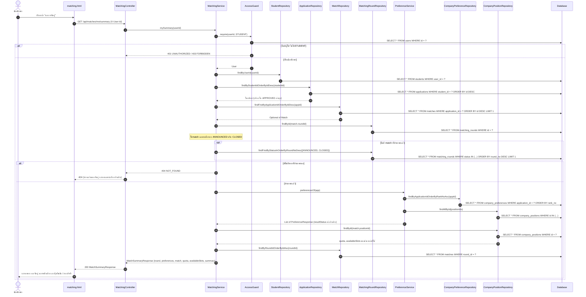
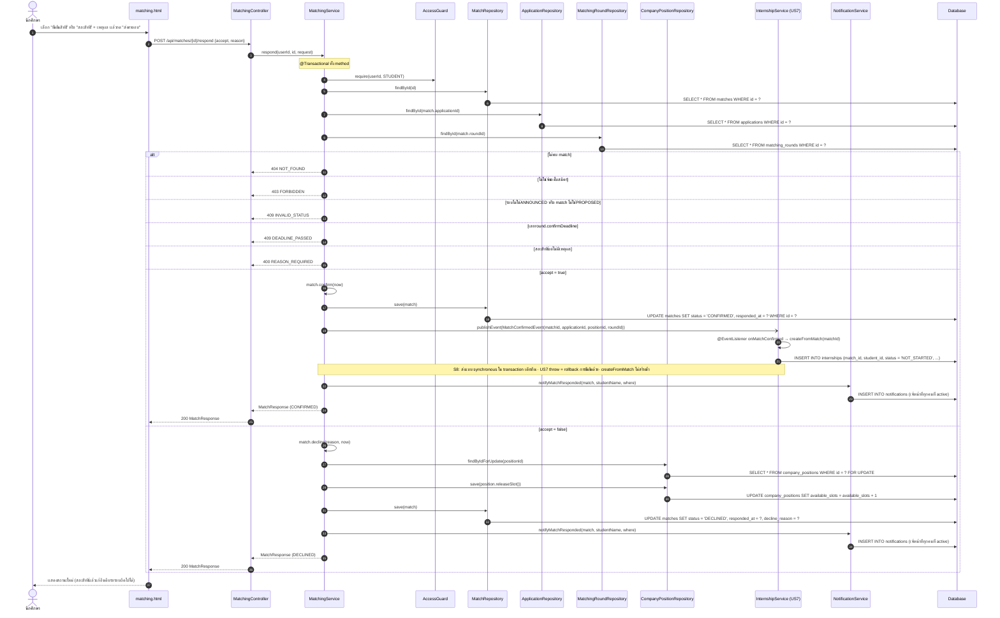
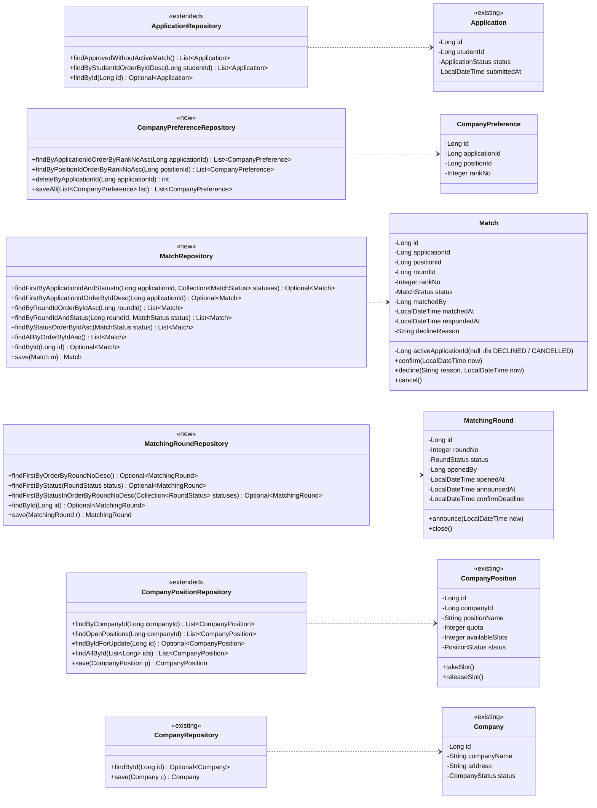
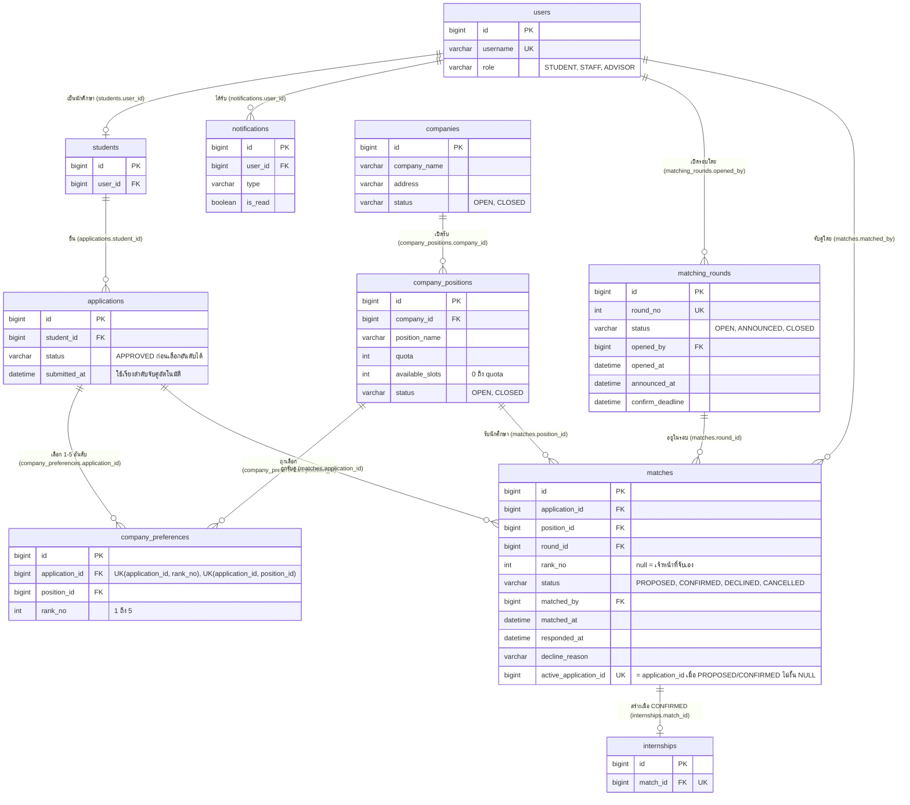

US6:Task2 : Design (UI Prototype, API Spec, Class Diagram, Sequence Diagram + ER Diagram)
-
User story U6: นักศึกษาที่ใบสมัครได้รับอนุมัติเลือกตำแหน่งงานที่สนใจ (จัดอันดับ 1–5) --> เจ้าหน้าที่จับคู่นักศึกษากับบริษัทตามโควตาเป็นรอบ --> ประกาศผลรายอันดับ นักศึกษายืนยัน/สละสิทธิ์ และระบบแจ้งเตือน

> เอกสารของ Task นี้ตามเลข Task ของ Sprint 2 ใน Trello (การ์ด Task2:US6:Design)
>
> ฉบับนี้ปรับ API Spec และ diagram ทั้งหมดให้ตรงกับโค้ดบน `Develop` (ต่อยอดจาก entity ของ U4) และแก้ประเด็นที่ขัดกันตาม "ส่วนที่ 3 · ข้อตกลงการออกแบบ" · diagram ชุดเดิมใน Trello (จัดอันดับ 1–3 ไม่มีรอบ) ไม่ใช้แล้ว

แก้ตามรีวิว (12 พ.ย. 2569)
-
| # | ข้อรีวิว | สิ่งที่แก้ | อยู่ที่ |
|---|---|---|---|
| 1 | UI prototype มีหน้าเดียว | เพิ่มภาพหน้าจอจริง 3 ภาพ: เลือกตำแหน่ง 1–5, ผลการจับคู่ของนักศึกษา, `staff-matching.html` | ส่วนที่ 1 · UI prototype |
| 2 | หน้าจอแสดงข้อมูลที่ DTO ไม่มี | เลือก**แก้หน้าจอให้แสดงเท่าที่มีข้อมูล** (ไม่เพิ่ม field) · ตาราง "Figma ↔ ข้อมูลที่ใช้จริง" บอกว่าส่วนไหนของ Figma ตัดออก / แสดงจาก field ไหน | ส่วนที่ 1 · ตาราง Figma ↔ DTO |
| 3 | Sequence 4 ไม่ครบ | วาดใหม่เป็น 4a ดูผล (`mySummary` + `AccessGuard` + `CompanyPreferenceRepository` + `CompanyPositionRepository`) และ 4b ยืนยัน / สละสิทธิ์ (+ ส่ง `MatchConfirmedEvent` ให้ US7 สร้าง internship ด้วย `InternshipService.createFromMatch`) | ส่วนที่ 2 · Sequence 4a, 4b · ข้อตกลง S8 |
| 4 | ER และ DAO ไม่ตรงกัน | วาด ER ใหม่: ทุกเส้นมีชื่อและชื่อ FK · `matches.matched_by → users` · constraint 1 ใบสมัครมีผลที่ใช้อยู่ได้ 1 รายการ · DAO diagram ใส่ทุก method ตามโค้ด (`findAllByOrderByIdAsc`, `findByStatusOrderByIdAsc`, `findFirstByStatus`, `findFirstByStatusInOrderByRoundNoDesc`) · `findApprovedWithoutActiveMatch` ระบุ `ORDER BY submitted_at, id` | ส่วนที่ 2 · DAO class diagram, ER diagram · ข้อตกลง S7 |
| เล็กน้อย | ใครได้แจ้งเตือนตอนประกาศผล | ตารางผู้รับแจ้งเตือนทุกเหตุการณ์ (รวมคนที่จับคู่ไม่ได้) | ส่วนที่ 3 · ผู้รับแจ้งเตือน |
| เล็กน้อย | แก้ข้อมูลบริษัท 2 ทาง | ระบุว่าหน้าไหนเรียก endpoint ไหน | ส่วนที่ 1 · UI prototype · ข้อตกลง D2 |
| เล็กน้อย | US7 ใช้ "PROPOSED เกิน 7 วัน" | ให้ US7 ใช้ `MatchResponse.confirmDeadline` (= `matching_rounds.confirm_deadline`) แทน | ข้อตกลง S9 |

# ส่วนที่ 1 · Design UI & DTO & API

UI prototype
-
Figma: [cs261_Project](https://www.figma.com/design/aQ0E4jUB8uQuVsPu3SlssR/cs261_Project?node-id=0-1&t=O2VGSYyotuCfWPgw-1)

| หน้า | ผู้ใช้ | หน้าที่ | Endpoint ที่หน้านี้เรียก |
|---|---|---|---|
| `matching.html` | นักศึกษา | เลือกตำแหน่ง 1–5 อันดับ · ดูผลการจับคู่ (summary) · ยืนยัน / สละสิทธิ์ | `GET /api/companies`, `GET /api/companies/{id}`, `GET`·`PUT /api/applications/{id}/preferences`, `GET /api/matches/me/summary`, `POST /api/matches/{id}/respond` |
| `staff-matching.html` | เจ้าหน้าที่ | จัดการบริษัท ตำแหน่ง และโควตา · เปิดรอบ · จับคู่อัตโนมัติ / จับคู่เอง / ยกเลิก · ประกาศผล | `GET /api/matching/rounds/current`, `POST /api/matching/rounds`, `POST /api/matching/auto`, `POST /api/matching/rounds/{id}/announce`, `GET /api/matches?roundId=`, `DELETE /api/matches/{id}`, `GET`·`POST /api/companies`, `POST /api/companies/{id}/positions`, `PUT /api/positions/{id}`, `GET /api/matching/candidates`, `POST /api/matches` |

> แก้ข้อมูลบริษัท: หน้า `staff-matching.html` **เพิ่มบริษัท** (`POST /api/companies`) และ**แก้โควตา** (`PUT /api/positions/{id}`) เท่านั้น · แก้ชื่อ / ที่อยู่บริษัทใช้ `PUT /api/companies/{id}` (US6) · **เปิด / ปิดรับบริษัท**ใช้ `PUT /api/staff/companies/{id}` ของ U4 ตามเดิม (ดู D2)

**1. Figma · นักศึกษา · ผลการจับคู่ (ภาพแนวคิด)**

> หน้านักศึกษา: ดูผลประกาศรอบที่ 1 · การ์ดอันดับ 1–5 พร้อมสถานะ · ปุ่มยืนยันสิทธิ์ / สละสิทธิ์ · สรุปผลด้านขวา · ส่วนที่ DTO ไม่มีข้อมูลรองรับดูตาราง "Figma ↔ ข้อมูลที่ใช้จริง" ด้านล่าง

**2. นักศึกษา · เลือกตำแหน่ง 1–5 อันดับ (`matching.html` ก่อนประกาศผล)**

> dropdown แต่ละอันดับแสดง "ว่าง `availableSlots`/`quota`" จาก `PositionResponse` · ตำแหน่งโควตาเต็มแสดงแต่เลือกไม่ได้ · กด "บันทึกอันดับ" = `PUT /api/applications/{id}/preferences`

**3. นักศึกษา · ผลการจับคู่ (`matching.html` หลังประกาศผล)**

> ข้อมูลทั้งหน้ามาจาก `GET /api/matches/me/summary` (`MatchSummaryResponse`) · ป้ายใต้แต่ละอันดับ = `PreferenceResponse.resultStatus` · ยืนยัน / สละสิทธิ์ = `POST /api/matches/{id}/respond` · หลังได้รับการจับคู่แก้อันดับไม่ได้

**4. เจ้าหน้าที่ · จับคู่บริษัท (`staff-matching.html`)**

> บนลงล่าง: รอบการจับคู่ (เปิดรอบใหม่ / จับคู่อัตโนมัติ / ประกาศผล + รายการที่จับไม่ได้พร้อมเหตุผล) · ผลการจับคู่ของรอบ (ยกเลิกได้) · บริษัทและตำแหน่ง (เพิ่มบริษัท เพิ่มตำแหน่ง แก้โควตา) · นักศึกษาที่เลือกตำแหน่ง (จับคู่เอง)
>
> ภาพ 2–4 เป็นหน้าจริงจาก `frontend/` (ข้อมูลตัวอย่าง)

Figma ↔ ข้อมูลที่ใช้จริง
-
เลือกแก้หน้าจอให้แสดงเท่าที่มีข้อมูล ไม่เพิ่ม field ใน DTO (ตัดสินใจตามรีวิวข้อ 2) · หน้าจริง (ภาพ 3) ทำตามตารางนี้แล้ว

| สิ่งที่ Figma แสดง | ข้อมูลที่มีใน DTO | หน้าจริงแสดงอย่างไร |
|---|---|---|
| แต่ละอันดับ "โควตารับ 3 ตำแหน่ง · ยืนยันสิทธิ์แล้ว 1/3 คน" + แถบโควตา | `PositionResponse.quota`, `availableSlots` · ไม่มีจำนวนที่**ยืนยันแล้ว** | แสดง "ว่าง `availableSlots`/`quota`" ใน dropdown · ตัด "ยืนยันสิทธิ์แล้ว x/y" และแถบโควตาออก · โควตาของตำแหน่งที่ได้แสดงจาก `MatchSummaryResponse.quota` |
| สถานะอันดับ "ผ่าน / ไม่ผ่าน" | `resultStatus` = `MATCHED` / `NOT_SELECTED` | ป้าย "ได้อันดับนี้" / "ไม่ได้อันดับนี้" |
| สถานะอันดับ "ปิดรับ–โควตาเต็ม" | `availableSlots = 0` (ไม่ใช่ค่าใน `resultStatus`) | แสดง "(โควตาเต็ม 0/2)" ใน dropdown ของอันดับนั้น · ป้าย `resultStatus` ยังเป็นค่าเดิม |
| สถานะอันดับ "รอประกาศผลครั้งที่ 2" | `resultStatus = PENDING` | ป้าย "รอประกาศผล" (ไม่ระบุครั้งที่) |
| "รอประกาศผลครั้งที่ 2 วันที่ 25 พ.ค." | ไม่มี — รอบถัดไปยังไม่ถูกสร้างจนเจ้าหน้าที่เปิดรอบ | ตัดออก · แสดงแค่ "รอบที่ n · สถานะรอบ · ยืนยันสิทธิ์ภายใน `round.confirmDeadline`" |
| สถานที่ปฏิบัติงาน · ระยะเวลา [วันเริ่ม]–[วันสิ้นสุด] | `Company.address` มีแต่ไม่อยู่ใน `MatchResponse` · ไม่มีวันเริ่ม–สิ้นสุดใน `Company` / `CompanyPosition` | ตัดออกจากหน้าผลจับคู่ · ที่อยู่บริษัทดูได้จาก `GET /api/companies/{id}` · วันฝึกงานเป็นข้อมูลของ internship (US7) |
| กล่อง "สรุปผลของคุณ" ด้านขวา | `MatchSummaryResponse.summary` (ข้อความ) + `preferences` | แสดงข้อความ `summary` ด้านบนการ์ดผลจับคู่ |

API Specification · 19 endpoint
-
ทุก request ส่ง header `X-User-Id` = `userId` ที่ได้จาก `POST /api/auth/login` (U1) · error ทุกตัวตอบเป็น `{"code": "...", "message": "..."}` · ไม่ส่ง header = `401 UNAUTHORIZED` · role ไม่ตรง = `403 FORBIDDEN`

ช่อง "สถานะ": **ใหม่** = endpoint ใหม่ของ US6 · **แก้** = endpoint เดิมของ U4 ที่แก้ response

| Method | Endpoint | สถานะ | ผู้ใช้ | Request | Response | Error (นอกจาก 401 / 403) | หน้าที่ |
|---|---|---|---|---|---|---|---|
| GET | /api/companies | แก้ | ทุกคน | – | List&lt;CompanyResponse&gt; | – | รายชื่อบริษัทที่เปิดรับ พร้อมจำนวนตำแหน่งและที่ว่าง (เพิ่ม `openPositions`, `remainingQuota`) |
| GET | /api/companies/{id} | ใหม่ | ทุกคน | – | CompanyDetailResponse | 404 NOT_FOUND | รายละเอียดบริษัทและตำแหน่งทั้งหมด |
| POST | /api/companies | ใหม่ | เจ้าหน้าที่ | CompanyRequest | CompanyResponse (201) | 400 VALIDATION_ERROR | เพิ่มบริษัท |
| PUT | /api/companies/{id} | ใหม่ | เจ้าหน้าที่ | CompanyRequest | CompanyResponse | 400 VALIDATION_ERROR · 404 NOT_FOUND | แก้ชื่อ / ที่อยู่บริษัท (เปิด–ปิดรับใช้ `PUT /api/staff/companies/{id}` ของ U4) |
| POST | /api/companies/{id}/positions | ใหม่ | เจ้าหน้าที่ | PositionRequest | PositionResponse (201) | 400 VALIDATION_ERROR · 404 NOT_FOUND | เพิ่มตำแหน่งและโควตา |
| PUT | /api/positions/{id} | ใหม่ | เจ้าหน้าที่ | PositionRequest | PositionResponse | 400 QUOTA_BELOW_MATCHED · 404 NOT_FOUND | แก้ตำแหน่ง · ลดโควตาต่ำกว่าจำนวนที่จับคู่แล้วไม่ได้ |
| GET | /api/applications/{id}/preferences | ใหม่ | นักศึกษา (เจ้าของ), เจ้าหน้าที่ | – | List&lt;PreferenceResponse&gt; | 404 NOT_FOUND | ดูอันดับที่เลือกไว้ พร้อมผลรายอันดับ (`resultStatus`) |
| PUT | /api/applications/{id}/preferences | ใหม่ | นักศึกษา (เจ้าของ) | PreferenceRequest | List&lt;PreferenceResponse&gt; | 400 INVALID_PREFERENCE · 409 APPLICATION_NOT_APPROVED · 409 ALREADY_MATCHED | บันทึกตำแหน่ง 1–5 อันดับ (แทนที่ของเดิมทั้งหมด) · ใบสมัครต้อง `APPROVED` และยังไม่มีผลจับคู่ |
| GET | /api/matching/candidates?positionId= | ใหม่ | เจ้าหน้าที่ | – | List&lt;CandidateResponse&gt; | 404 NOT_FOUND | นักศึกษาที่เลือกตำแหน่งนี้ พร้อมอันดับ |
| POST | /api/matching/auto | ใหม่ | เจ้าหน้าที่ | – | AutoMatchResponse | 409 NO_OPEN_ROUND | จับคู่อัตโนมัติในรอบที่เปิดอยู่ · ไล่ใบสมัคร**ตามเวลายื่น (ยื่นก่อนได้ก่อน)** แต่ละใบไล่อันดับ 1 → 5 จนได้ · ใบที่จับไม่ได้คืนพร้อมเหตุผล |
| POST | /api/matches | ใหม่ | เจ้าหน้าที่ | MatchRequest | MatchResponse (201) | 409 NO_OPEN_ROUND · 409 APPLICATION_NOT_APPROVED · 409 ALREADY_MATCHED · 409 QUOTA_FULL | จับคู่เอง 1 ใบ (ในรอบที่เปิดอยู่) |
| GET | /api/matches?status=&roundId= | ใหม่ | เจ้าหน้าที่ | – | List&lt;MatchResponse&gt; | – | ผลจับคู่ กรองได้ 4 แบบ: ไม่ส่งทั้งคู่ = ทั้งหมด (`findAllByOrderByIdAsc`) · `status` อย่างเดียว (`findByStatusOrderByIdAsc`) · `roundId` (`findByRoundIdOrderByIdAsc`) · `roundId` + `status` (กรอง status จากผลของรอบ) |
| GET | /api/matches/me | ใหม่ | นักศึกษา | – | MatchResponse | 404 NOT_FOUND | ผลจับคู่ล่าสุดของตนเอง (404 ถ้ายังไม่มี หรือรอบยังไม่ประกาศผล) |
| GET | /api/matches/me/summary | ใหม่ | นักศึกษา | – | MatchSummaryResponse | 404 NOT_FOUND | ข้อมูลหน้าผลการจับคู่ทั้งหน้า: รอบ, ผลทุกอันดับ, โควตา, สรุปผล (404 ถ้ายังไม่ประกาศผล) |
| POST | /api/matches/{id}/respond | ใหม่ | นักศึกษา (เจ้าของ) | MatchDecisionRequest | MatchResponse | 400 REASON_REQUIRED · 404 NOT_FOUND · 409 INVALID_STATUS · 409 DEADLINE_PASSED | ยืนยันสิทธิ์ / สละสิทธิ์ (ต้องมีเหตุผล · คืนโควตา) · ต้องตอบก่อน `confirmDeadline` · ยืนยันแล้วสร้าง internship (S8) |
| DELETE | /api/matches/{id} | ใหม่ | เจ้าหน้าที่ | – | MatchResponse | 404 NOT_FOUND · 409 INVALID_STATUS | ยกเลิกผลจับคู่ PROPOSED / CONFIRMED (สถานะ `CANCELLED` คืนโควตา) |
| GET | /api/matching/rounds/current | ใหม่ | ทุกคน | – | MatchingRoundResponse | 404 NOT_FOUND | ดูรอบล่าสุด (404 ถ้ายังไม่มีรอบ) |
| POST | /api/matching/rounds | ใหม่ | เจ้าหน้าที่ | MatchingRoundRequest | MatchingRoundResponse (201) | 400 VALIDATION_ERROR · 409 ROUND_NOT_CLOSED | เปิดรอบใหม่ (ทีละรอบ) · รอบก่อนต้องประกาศผลและเลย `confirmDeadline` แล้ว ระบบปิดรอบเก่าเป็น `CLOSED` ให้ |
| POST | /api/matching/rounds/{id}/announce | ใหม่ | เจ้าหน้าที่ | – | MatchingRoundResponse | 404 NOT_FOUND · 409 INVALID_STATUS | ประกาศผลรอบ (`OPEN` → `ANNOUNCED`) · แจ้งเตือนนักศึกษาที่ได้รับการจับคู่ในรอบนี้ และนักศึกษาที่เลือกอันดับไว้แต่ยังไม่ได้จับคู่ (ดู "ผู้รับแจ้งเตือน") |

ค่าที่ใช้ใน DTO
-
| ค่า | ความหมาย |
|---|---|
| `MatchStatus` | `PROPOSED` (จับคู่แล้ว รอนักศึกษาตอบ) · `CONFIRMED` · `DECLINED` (สละสิทธิ์ / ไม่ตอบภายในกำหนด) · `CANCELLED` (เจ้าหน้าที่ยกเลิก) |
| `RoundStatus` | `OPEN` (จับคู่ได้) · `ANNOUNCED` (ประกาศแล้ว รอนักศึกษาตอบ) · `CLOSED` |
| `PreferenceResponse.resultStatus` | `PENDING` (ยังไม่ประกาศ) · `MATCHED` (ได้อันดับนี้) · `NOT_SELECTED` (ไม่ได้อันดับนี้) · "โควตาเต็ม" ไม่ใช่ค่าของ field นี้ ดูจาก `PositionResponse.availableSlots = 0` |
| `MatchSummaryResponse` | `round` (MatchingRoundResponse), `preferences` (List&lt;PreferenceResponse&gt;), `match` (null = ไม่ได้รับการจับคู่ในรอบที่ประกาศ), `quota` / `availableSlots` (ของตำแหน่งที่ได้), `summary` (ข้อความสรุป) |
| `MatchResponse.confirmDeadline` | คัดลอกจาก `matching_rounds.confirm_deadline` ของรอบที่ match อยู่ · US7 ใช้ค่านี้ (S9) |

API class diagram
-

DTO class
-

# ส่วนที่ 2 · Design Interaction ระหว่าง API–DAO–DB

Sequence Diagram
-

> Sequence 2: ไล่ใบสมัครตาม `submitted_at ASC, id ASC` (ยื่นก่อนได้ก่อน) · ชน `uk_match_active_application` ได้ 409 `ALREADY_MATCHED` · Sequence 3: แจ้งเตือนเฉพาะนักศึกษาที่ได้รับการจับคู่ และที่เลือกอันดับไว้แต่ยังไม่ได้

**Sequence 4a · นักศึกษาดูผลการจับคู่ (`GET /api/matches/me/summary`)** (แทน sequence 4 เดิม)

Mermaid source

**Sequence 4b · นักศึกษายืนยัน / สละสิทธิ์ (`POST /api/matches/{id}/respond`)**

Mermaid source

DAO class diagram
-

Mermaid source

Method ↔ ผู้ใช้ (ชื่อเดียวกับโค้ดและ T3)

| DAO | Method | Query | ใช้ใน |
|---|---|---|---|
| ApplicationRepository | `findApprovedWithoutActiveMatch` | `WHERE status = APPROVED AND NOT EXISTS (match PROPOSED / CONFIRMED) ORDER BY submitted_at ASC, id ASC` — **ยื่นก่อนได้ก่อน** | `autoMatch`, `announce` (หาคนที่จับคู่ไม่ได้) |
| MatchRepository | `findFirstByApplicationIdAndStatusIn` | ผลที่ใช้อยู่ของใบสมัคร (ส่ง `[PROPOSED, CONFIRMED]`) | `savePreferences`, `manualMatch`, `candidates` |
| MatchRepository | `findFirstByApplicationIdOrderByIdDesc` | ผลล่าสุดของใบสมัคร | `myMatch`, `mySummary`, `preferencesOf` |
| MatchRepository | `findAllByOrderByIdAsc` | ทั้งหมด | `GET /api/matches` ไม่ส่ง status / roundId |
| MatchRepository | `findByStatusOrderByIdAsc` | ตามสถานะ | `GET /api/matches?status=` |
| MatchRepository | `findByRoundIdOrderByIdAsc` | ตามรอบ | `GET /api/matches?roundId=` (+ กรอง status ถ้าส่ง), `announce` |
| MatchRepository | `findByRoundIdAndStatus` | ตามรอบและสถานะ | `openRound` → ปิดรอบเก่า (PROPOSED → DECLINED) |
| MatchingRoundRepository | `findFirstByOrderByRoundNoDesc` | รอบล่าสุด | `GET /api/matching/rounds/current`, `openRound` |
| MatchingRoundRepository | `findFirstByStatus` | รอบที่ `OPEN` (มีได้ทีละรอบ) | `autoMatch`, `manualMatch` (409 NO_OPEN_ROUND) |
| MatchingRoundRepository | `findFirstByStatusInOrderByRoundNoDesc` | รอบที่ประกาศล่าสุด (`[ANNOUNCED, CLOSED]`) | `mySummary` (DAO-U6-06 ใน T3) |
| CompanyPositionRepository | `findByIdForUpdate` | `SELECT ... FOR UPDATE` (`@Lock(PESSIMISTIC_WRITE)`) | `autoMatch`, `manualMatch`, คืนโควตา |

Extended API class diagram
-

> `MatchingService` ส่ง `MatchConfirmedEvent` เมื่อ CONFIRMED · `InternshipService` (US7) รับด้วย `@EventListener` แล้วเรียก `createFromMatch` (S8) · `ApiExceptionHandler` แปลง `uk_match_active_application` เป็น 409 `ALREADY_MATCHED` (S7)

ER diagram
-
ตารางใหม่: `company_preferences`, `matching_rounds`, `matches` · ตารางอื่นเป็นของเดิม (`notifications.type` เพิ่มค่า `MATCH_ANNOUNCED`, `MATCH_RESPONDED`, `MATCH_CANCELLED`) · `internships` เป็นตารางของ US7 แสดงเพื่อบอกความสัมพันธ์

Mermaid source

Constraint ของตาราง `matches`

| Constraint | นิยาม (MySQL 8.4) | เหตุผล |
|---|---|---|
| FK `matched_by` | `FOREIGN KEY (matched_by) REFERENCES users(id)` | รู้ว่าเจ้าหน้าที่คนไหนจับคู่ |
| FK `round_id`, `application_id`, `position_id` | อ้าง `matching_rounds`, `applications`, `company_positions` | |
| **1 ใบสมัครมีผลที่ใช้อยู่ได้ 1 รายการ** | คอลัมน์ `active_application_id BIGINT NULL` + `UNIQUE KEY uk_match_active_application (active_application_id)` · entity `Match` ตั้งค่า = `application_id` ตอนสร้าง (PROPOSED) และเป็น `NULL` เมื่อ `decline()` / `cancel()` · NULL ซ้ำกันได้ จึงมีผล DECLINED / CANCELLED หลายแถวได้ · MySQL ไม่มี partial index และ H2 (ใช้ตอน test) ไม่รองรับ generated column แบบนี้ จึงให้ entity ตั้งค่าเอง · ฐาน MySQL เดิมที่มีข้อมูลอยู่แล้ว: แถวเก่าได้ค่า NULL ต้องรัน `UPDATE matches SET active_application_id = application_id WHERE status IN ('PROPOSED','CONFIRMED')` ครั้งเดียว | กันใบสมัครเดียวมีผล PROPOSED / CONFIRMED 2 รายการพร้อมกัน แม้ request จะเข้ามาพร้อมกัน · ชั้นที่ 2 ต่อจากการเช็ก `findFirstByApplicationIdAndStatusIn` ในโค้ด · ชน constraint ตอบ `409 ALREADY_MATCHED` |

# ส่วนที่ 3 · ข้อตกลงการออกแบบ (แก้ประเด็นที่ขัดกับ U4 และ spec ฉบับแรก)

| # | ประเด็น | ข้อตกลง |
|---|---|---|
| D1 | จัดอันดับก่อนหรือหลังอนุมัติ | U6 จัดอันดับ**หลังใบสมัคร `APPROVED`** ในตารางใหม่ `company_preferences` · การจัดอันดับบริษัทของ U4 (ก่อนยื่นคำร้อง) ไม่แก้ ใช้เป็นข้อมูลความสนใจเบื้องต้นเหมือนเดิม |
| D2 | endpoint ซ้ำกับ U4 | ไม่ลบหรือแก้ endpoint ของ U4 (test ของ U4 ไม่พัง) · `GET /api/companies` แก้แค่เพิ่ม field ใน response · `PUT /api/staff/companies/{id}` (U4) ใช้**เปิด / ปิดรับบริษัท** · `PUT /api/companies/{id}` (US6) ใช้**แก้ชื่อ / ที่อยู่บริษัท** · หน้า `staff-matching.html` เรียกเฉพาะ `POST /api/companies` และ `PUT /api/positions/{id}` (ตารางหน้าในส่วนที่ 1) |
| D3 | จัดอันดับ "บริษัท" หรือ "ตำแหน่ง" | จัดอันดับเป็น**ตำแหน่ง** (`positionIds`) เพราะโควตาอยู่ที่ตำแหน่ง · ใช้ `CompanyPosition` ของ U4 ไม่สร้าง entity ตำแหน่งใหม่ |
| D4 | 1–5 หรือครบ 5 | เลือกได้ **1–5 อันดับ** (อย่างน้อย 1 ไม่ซ้ำ ตำแหน่งต้อง `OPEN`) |
| S1 | `GET /api/companies` | ติด "แก้" · `CompanyResponse` เพิ่ม `openPositions`, `remainingQuota` |
| S2 | การปิดรอบ | รอบ: `OPEN` → (announce) `ANNOUNCED` → `CLOSED` · ปิดรอบตอนเปิดรอบใหม่ ถ้ารอบเก่าเลย `confirmDeadline` แล้ว · ผลที่ยัง `PROPOSED` เปลี่ยนเป็น `DECLINED` ("ไม่ตอบภายในกำหนด") และคืนโควตา |
| S3 | สละสิทธิ์คืนโควตา | คืน · `DECLINED` และ `CANCELLED` คืนโควตาทุกกรณี |
| S4 | `/api/matches/me` ก่อนประกาศ | ตอบ 404 จนกว่ารอบจะ `ANNOUNCED` (กฎเดียวกับ `/me/summary`) |
| S5 | `roundNo` กับ `id` | ใช้ `roundId` ทุกที่ (`/api/matches?roundId=`) · `roundNo` มีไว้แสดงผลอย่างเดียว |
| S6 | error code | ระบุในตาราง API Spec แล้ว ใช้เป็น expected result ใน Task3 |
| S7 | ลำดับจับคู่อัตโนมัติ / กันจับคู่ซ้ำ | ไล่ใบสมัครตาม `submitted_at ASC, id ASC` (ยื่นก่อนได้ก่อน) แต่ละใบไล่อันดับ 1 → 5 · กันใบสมัครเดียวมีผลที่ใช้อยู่ 2 รายการด้วย (1) เช็กในโค้ด (2) unique บนคอลัมน์ `active_application_id` ของ `matches` (entity ตั้งค่าเอง) |
| S8 | ยืนยันสิทธิ์ → internship (US7) | **US6 เป็นผู้เริ่ม**: `MatchingService.respond()` ส่ง `MatchConfirmedEvent(matchId, applicationId, positionId, roundId)` ทันทีหลัง `CONFIRMED` · **US7 รับ** ด้วย `@EventListener` (synchronous ใน transaction เดียวกัน) แล้วเรียก `InternshipService.createFromMatch` · สร้างไม่สำเร็จ rollback ทั้งคู่ · `createFromMatch` ไม่สร้างซ้ำถ้ามีอยู่แล้ว (SV-I02 ของ US7) · ใช้ event เพราะโค้ด US7 ยังไม่ merge: US6 ไม่ต้อง import คลาสของ US7 และ test ของ US6 ไม่ขึ้นกับ US7 |
| S9 | ป้ายเตือน US7 "ยังไม่ยืนยัน" | US7 ใช้ `MatchResponse.confirmDeadline` (กำหนดยืนยันของรอบ) แทนการนับ "PROPOSED เกิน 7 วัน" เพื่อให้ตรงกับที่นักศึกษาเห็น |

โควตาคงเหลือเก็บใน `CompanyPosition.availableSlots` (ของ U4): จับคู่ (`PROPOSED`) ลด 1 · `DECLINED` / `CANCELLED` คืน 1 · ใช้ `findByIdForUpdate` (`@Lock(PESSIMISTIC_WRITE)`) กันโควตาเกินตอนจับคู่พร้อมกัน

ผู้รับแจ้งเตือน
-
| เหตุการณ์ | Method (`NotificationService`) | ผู้รับ | ไม่ได้รับ |
|---|---|---|---|
| ประกาศผลรอบ | `notifyMatchAnnounced` | (1) นักศึกษาที่มีผลจับคู่ในรอบนี้: "ได้รับการจับคู่กับ ... กรุณายืนยันภายใน `confirmDeadline`" (2) นักศึกษาใบ `APPROVED` ที่**เลือกอันดับไว้แต่ยังจับคู่ไม่ได้**: "รอบนี้ยังไม่ได้รับการจับคู่ แก้อันดับรอรอบถัดไปได้" | นักศึกษาที่ยังไม่ได้เลือกอันดับเลย · นักศึกษาที่มีผลที่ใช้อยู่จากรอบก่อน |
| นักศึกษายืนยัน / สละสิทธิ์ | `notifyMatchResponded` | เจ้าหน้าที่ทุกคนที่ active (role STAFF) | |
| เจ้าหน้าที่ยกเลิกผล | `notifyMatchCancelled` | นักศึกษาเจ้าของผล **เฉพาะเมื่อรอบประกาศแล้ว** | ก่อนประกาศ (นักศึกษายังไม่เห็นผล) |

# ส่วนที่ 4 · ความสอดคล้องกับโค้ดที่มีอยู่ (บน Develop หลัง merge U4)

| ชั้น | ใช้ของเดิม | เพิ่มใหม่ (US6) |
|---|---|---|
| Entity | `Company`, `CompanyPosition` (+ `takeSlot()`, `releaseSlot()`), `Application`, `PositionStatus` | `CompanyPreference`, `Match`, `MatchingRound`, `MatchStatus`, `RoundStatus` |
| DAO | `repository/CompanyRepository`, `repository/CompanyPositionRepository` (+ `findByIdForUpdate`), `dao/ApplicationRepository` (+ `findApprovedWithoutActiveMatch`) | `dao/CompanyPreferenceRepository`, `dao/MatchRepository`, `dao/MatchingRoundRepository` |
| API | `RankingController` (`GET /api/companies` เดิม), `CompanyService` (เพิ่ม method) | `CompanyController`, `PreferenceController` + `PreferenceService`, `MatchingController` + `MatchingService` |
| ใช้ร่วม | `ErrorResponse(code, message)`, `ApiException`, `AccessGuard.require(userId, Role...)`, `NotificationService` (+ 3 method), `NotificationType` (+ 3 ค่า) | |

โค้ดที่แก้ตามรีวิว

| รายการ | ไฟล์ | Test | ที่มา |
|---|---|---|---|
| คอลัมน์ `active_application_id` + `uk_match_active_application` (ตั้งค่าใน constructor / `decline()` / `cancel()`) | `entity/Match.java` | DAO-U6-05b `oneActiveMatchPerApplication` | S7 · รีวิวข้อ 4 |
| flush หลังบันทึก match ให้ชน constraint ใน service | `MatchingService.take()` | | S7 |
| แปลง `DataIntegrityViolationException` (`uk_match_active_application`) เป็น 409 `ALREADY_MATCHED` | `controller/ApiExceptionHandler.java` | | S7 |
| ส่ง `MatchConfirmedEvent` เมื่อ CONFIRMED | `service/MatchConfirmedEvent.java`, `MatchingService.respond()` | U6-SVC-S03 `confirm`, `declineReleasesSlot` | S8 · รีวิวข้อ 3 |
| `InternshipService` รับ `MatchConfirmedEvent` แล้ว `createFromMatch` | ฝั่ง US7 (ยังไม่ merge) | SV-I01, SV-I02 ของ US7 | S8 |
