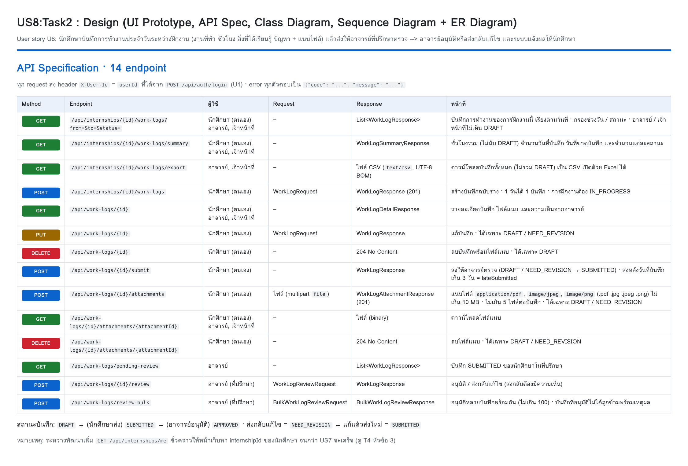
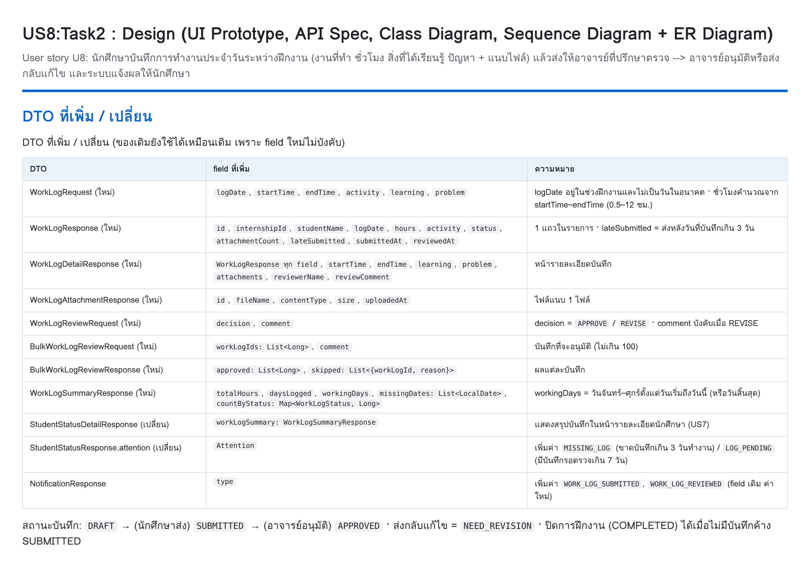
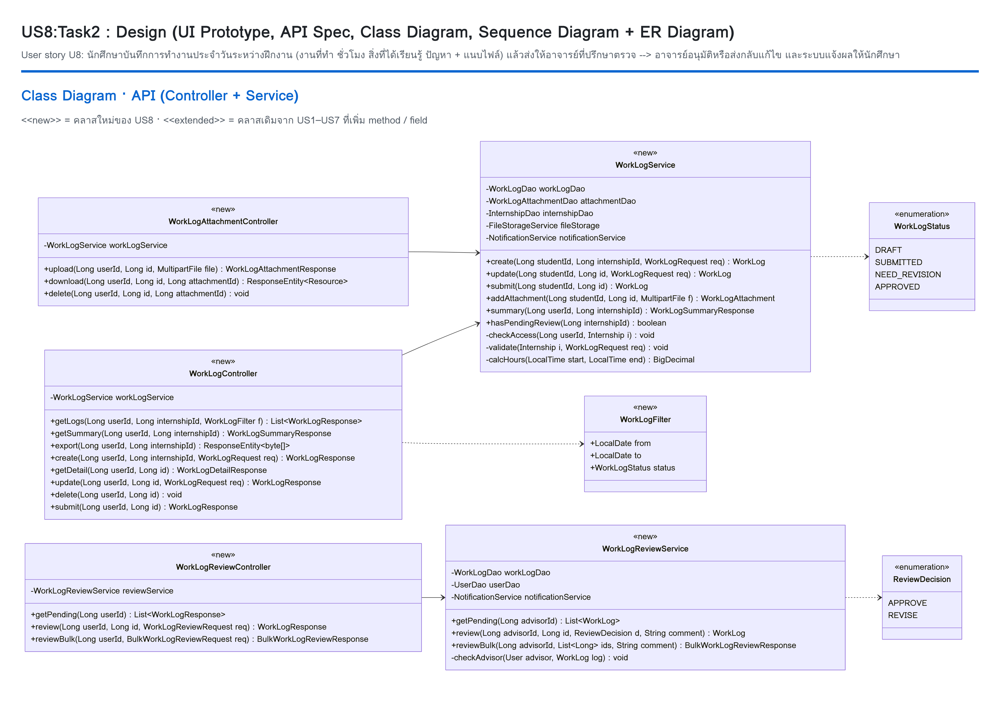
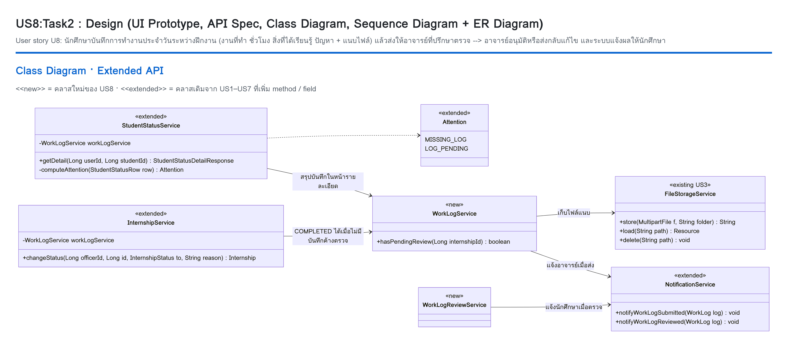
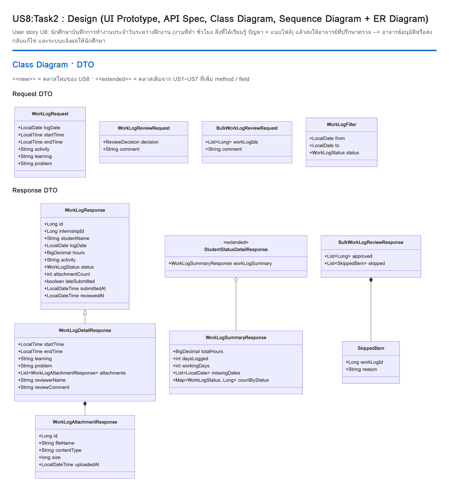
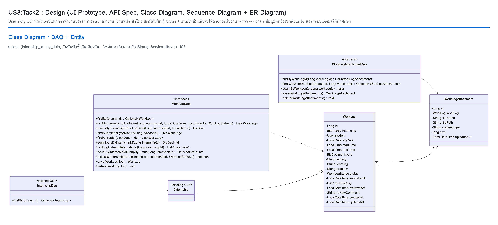
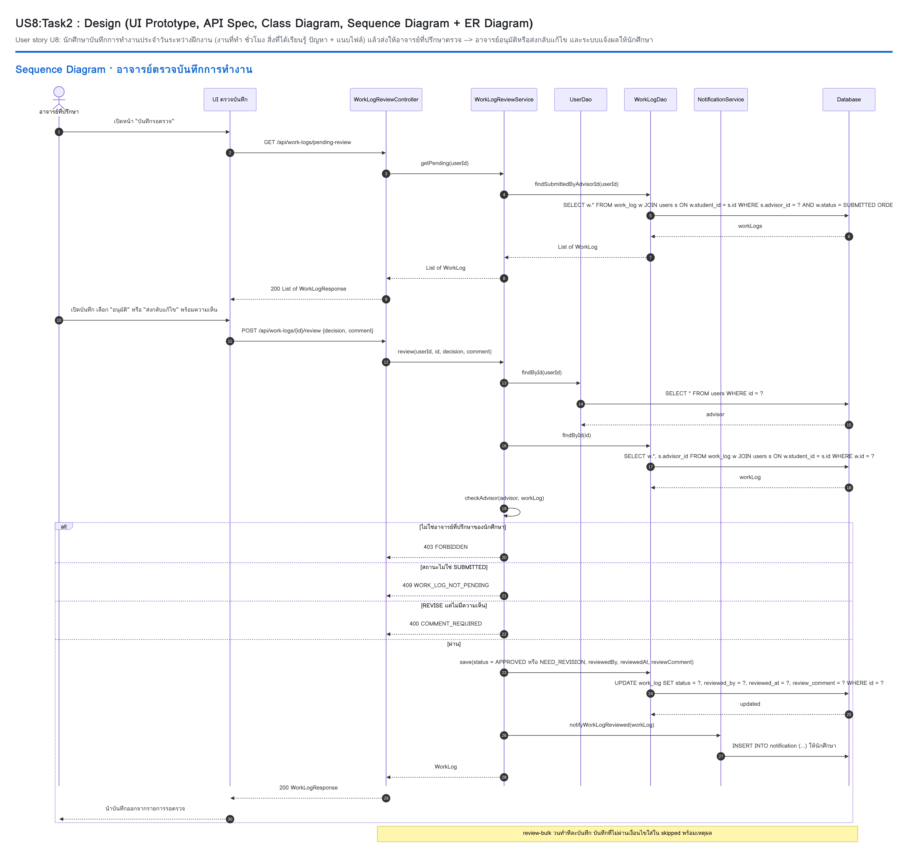
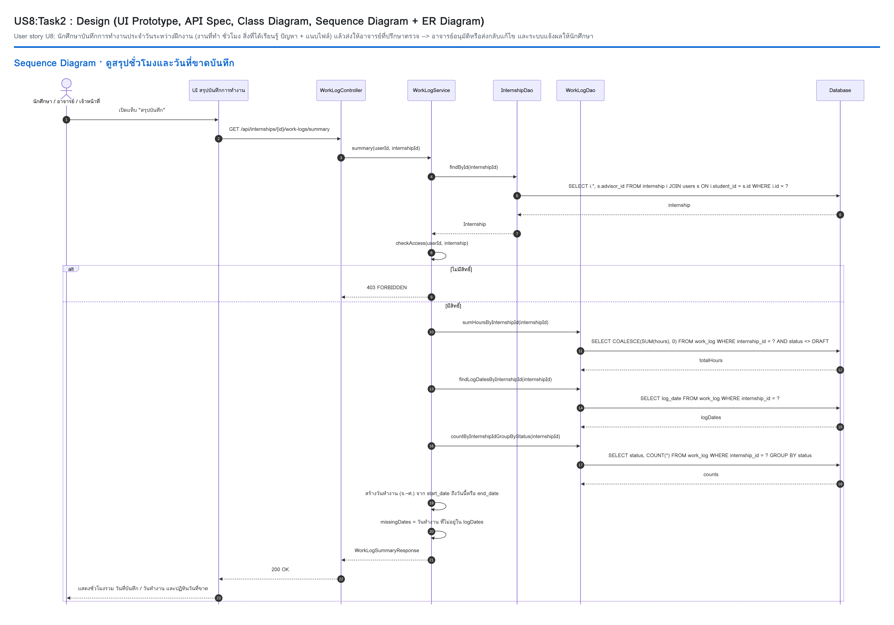
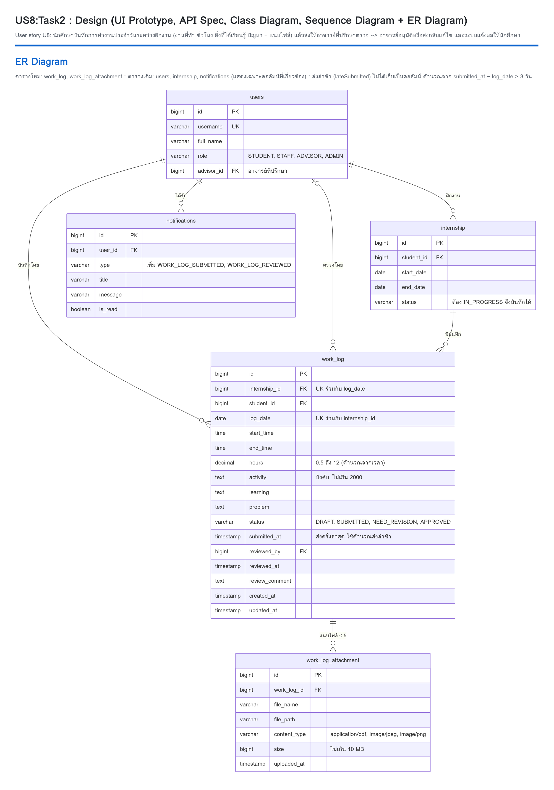

# Task2:US8:Design (UI Prototype, API Spec, Class Diagram, Sequence Diagram + ER Diagram)

User story U8: นักศึกษาบันทึกการทำงานประจำวันระหว่างฝึกงาน (งานที่ทำ ชั่วโมง สิ่งที่ได้เรียนรู้ ปัญหา + แนบไฟล์) แล้วส่งให้อาจารย์ที่ปรึกษาตรวจ → อาจารย์อนุมัติหรือส่งกลับแก้ไข และระบบแจ้งผลให้นักศึกษา

อ้างอิง Requirement: [T1.md](T1.md) · Test cases: [T3.md](T3.md)

## 1. UI Prototype

หน้าบันทึกการทำงานประจำวันของนักศึกษา (`frontend/worklog.html`): ฟอร์มรายวัน (วันที่ เวลาเริ่ม–สิ้นสุด คำนวณชั่วโมงอัตโนมัติ งานที่ทำ สิ่งที่ได้เรียนรู้ ปัญหา ไฟล์แนบ) การ์ดสรุปชั่วโมงและวันที่ขาดบันทึก และประวัติพร้อมสถานะ

## 2. API Specification

## 3. DTO

## 4. Class Diagram

### API (Controller + Service)

### Extended API (คลาสเดิมที่เพิ่ม method / field)

### DTO

### DAO + Entity

## 5. Sequence Diagram

### นักศึกษาบันทึก แนบไฟล์ และส่งบันทึก

### อาจารย์ตรวจบันทึกการทำงาน

### ดูสรุปชั่วโมงและวันที่ขาดบันทึก

## 6. ER Diagram

