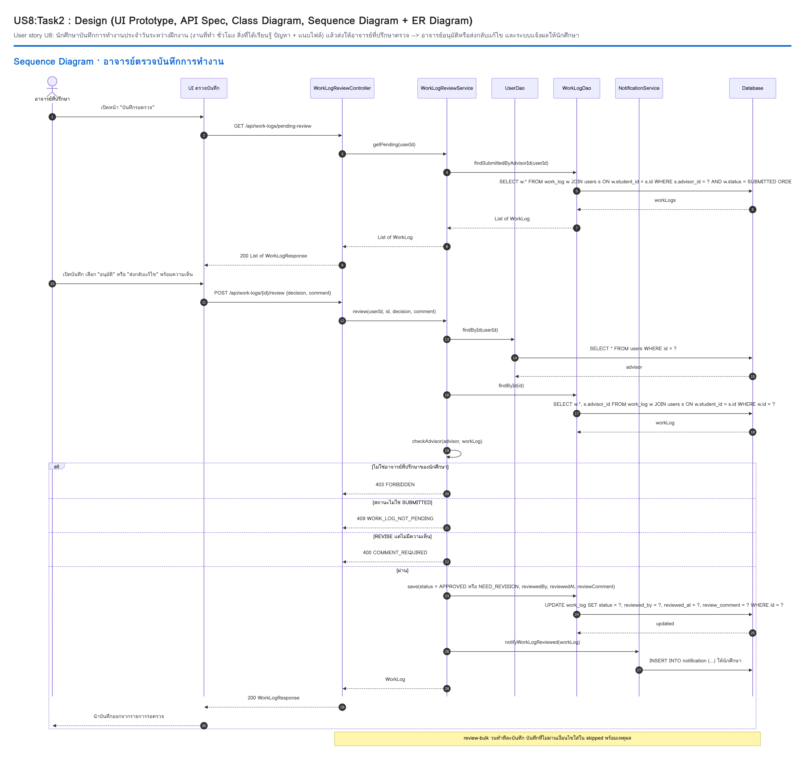
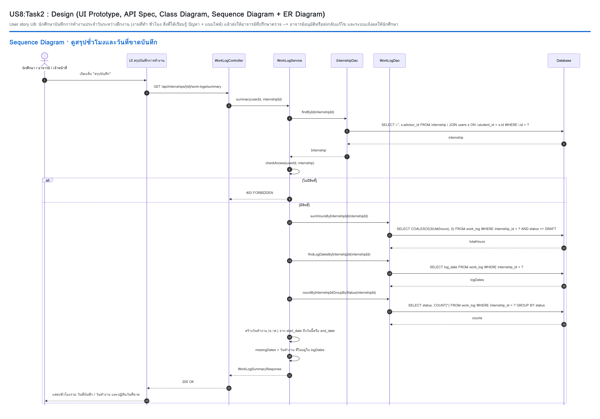

US8:TaskEND : Run Test (Integration Test + System Test + User Acceptance Test)
-
User story U8: นักศึกษาบันทึกการทำงานประจำวันระหว่างฝึกงาน (งานที่ทำ ชั่วโมง สิ่งที่ได้เรียนรู้ ปัญหา + แนบไฟล์) แล้วส่งให้อาจารย์ที่ปรึกษาตรวจ --> อาจารย์อนุมัติหรือส่งกลับแก้ไข และระบบแจ้งผลให้นักศึกษา

> เอกสารของ Task นี้ตามรูปแบบ TaskEND ของ U5 · อ้างอิง Requirement [T1](T1.md) (UC8-1 ถึง UC8-9, BR8-1 ถึง BR8-11) · Design [T2](T2.md) · Unit test [T3](T3.md) · Development [T4](T4.md)

เคสที่ใช้อ้างอิงในไฟล์นี้ (จาก Use case ใน T1)
-
| เคส | ความหมาย |
|---|---|
| UC8-1 | นักศึกษาบันทึกการทำงานรายวัน (ฉบับร่าง) |
| UC8-2 | นักศึกษาส่งบันทึกให้อาจารย์ตรวจ (+ แจ้งเตือนอาจารย์ · ป้ายส่งล่าช้า) |
| UC8-3 | นักศึกษาแก้ไข / ลบบันทึก (แก้ได้เฉพาะ DRAFT / NEED_REVISION · ลบได้เฉพาะ DRAFT) |
| UC8-4 | นักศึกษาแนบไฟล์หลักฐาน (PDF / JPG / PNG ≤ 10 MB ≤ 5 ไฟล์) |
| UC8-5 | ดูบันทึกและสรุปชั่วโมง (สิทธิ์ตาม BR8-11) |
| UC8-6 | อาจารย์ดูบันทึกรอตรวจ |
| UC8-7 | อาจารย์อนุมัติ / ส่งกลับแก้ไขพร้อมความเห็น (+ แจ้งเตือนนักศึกษา) |
| UC8-8 | อาจารย์อนุมัติหลายบันทึกพร้อมกัน |
| UC8-9 | อาจารย์ / เจ้าหน้าที่ส่งออกบันทึกเป็น CSV |

ข้อมูลตั้งต้นที่ทุกส่วนใช้ (`DemoDataSeeder` + `WorkLogDemoSeeder` หลัง `docker compose down -v`)
-
| id (`X-User-Id`) | username | ชื่อ | บทบาท | ข้อมูลที่เกี่ยวกับ U8 |
|---|---|---|---|---|
| 1 | `staff01` | (ตาม `DemoDataSeeder`) | STAFF | – |
| 2 | `advisor01` | (ตาม `DemoDataSeeder`) | ADVISOR | อาจารย์ที่ปรึกษาของนักศึกษา U8 ทั้ง 3 คน |
| `{A}` | `6609650031` | วรเมธ บันทึกดี | STUDENT | การฝึกงาน `{iA}` · IN_PROGRESS · เริ่มวันจันทร์เมื่อ 4 สัปดาห์ก่อน · ยังไม่มีบันทึก |
| `{B}` | `6609650032` | ปิยะนุช ใส่ใจงาน | STUDENT | การฝึกงาน `{iB}` · IN_PROGRESS · ยังไม่มีบันทึก |
| `{C}` | `6609650033` | กิตติพัฒน์ รอฝึก | STUDENT | ไม่มีการฝึกงาน |

U8 ใช้นักศึกษาชุดของตัวเอง `6609650031`–`33` (สร้างโดย `WorkLogDemoSeeder`) ไม่ใช้นักศึกษาของ U1–U5 (`01`–`08`), U6 (`11`–`14`) และ U7 (`21`–`27`) · id ของ 3 คนนี้ขึ้นกับลำดับการ seed ของ story อื่น จึงเขียนเป็น `{A}` `{B}` `{C}` ให้ดูค่าจริงจาก `GET /api/users/{username}` และการฝึกงาน `{iA}` `{iB}` จาก `GET /api/work-logs/my-internship` (Postman collection หาให้อัตโนมัติในขั้น 00 / 01-1)

รหัสผ่านทุกบัญชี `1234` · ดูฐานข้อมูล: `docker exec -it cs261-db mysql -uroot -proot1234 cs261db`


# ส่วนที่ 1 · Design Integration Test UI–API

ขอบเขต
-
- หน้า `worklog.html` (นักศึกษา) และ `notifications.html` (นักศึกษา / อาจารย์) เรียก backend จริง (ฐานข้อมูลใหม่ + seeder)
- หน้าอาจารย์ตรวจบันทึกยังไม่มี UI (ดู T4 หัวข้อ 3) ฝั่งอาจารย์จึงยิง API ด้วย Postman แล้วตรวจผลบนหน้าเว็บของนักศึกษา
- วิธีตรวจ: DevTools แท็บ Network ดู request (`X-User-Id`, body) / response และดูผลบนหน้าจอ

Design Integration Test ระหว่าง UI กับ API
-
| TC ID | Scenario | Input (บนหน้าเว็บ) | Request ที่ต้องเห็น | Response | Expected บนหน้าเว็บ |
|---|---|---|---|---|---|
| IT-UA-01 | เปิดหน้าบันทึก (UC8-5) | `6609650031` login แล้วกดเมนู "บันทึกการทำงาน" | GET /api/work-logs/my-internship · GET /api/internships/{iA}/work-logs · GET .../summary | 200, 200 `[]`, 200 | วันที่ตั้งต้นเป็นวันนี้ · ประวัติ "ยังไม่มีบันทึก" · การ์ดสรุป 0 ชม. วันที่ขาดบันทึกตรงกับ `missingDates` · แถบกำหนดส่ง "กำหนดส่งบันทึกวันที่ …" |
| IT-UA-02 | บันทึกแบบร่าง (UC8-1) | วันที่ = เมื่อวาน (วันทำงาน) 09:00–12:00 งานที่ทำ + สิ่งที่ได้เรียนรู้ → "บันทึกแบบร่าง" | POST /api/internships/{iA}/work-logs | 201 `status: DRAFT`, `hours: 3` | ช่องชั่วโมงแสดง "3 ชั่วโมง" ก่อนกด · กล่อง "บันทึกฉบับร่างแล้ว" · ประวัติมีแถว "ฉบับร่าง 3 ชม." · ชั่วโมงสะสมยังไม่นับ |
| IT-UA-03 | ตรวจข้อมูลฝั่งหน้าเว็บ (UC8-1) | เวลาสิ้นสุดก่อนเวลาเริ่ม · วันที่พรุ่งนี้ · 06:00–19:00 · ไม่กรอกงานที่ทำ (ทีละกรณี) | ไม่มี request | – | ข้อความ "เวลาสิ้นสุดต้องหลังเวลาเริ่ม" / "ไม่สามารถบันทึกวันที่ในอนาคตได้" / "ชั่วโมงทำงานต้องอยู่ระหว่าง 0.5 ถึง 12 ชั่วโมง" / "กรุณากรอกงานที่ทำ" · ข้อมูลที่กรอกไม่หาย |
| IT-UA-04 | ข้อผิดพลาดจาก server (UC8-1) | Postman ยิงบันทึกวันเดียวกับ IT-UA-02 ขณะหน้าเว็บเปิดอยู่ แล้วหน้าเว็บกด "ส่งบันทึก" วันเดียวกันก่อนโหลดประวัติใหม่ | POST /api/internships/{iA}/work-logs | 409 `DUPLICATE_LOG_DATE` | แสดงข้อความจาก server ข้อมูลที่กรอกไม่หาย (ถ้าประวัติโหลดแล้ว หน้าเว็บกันไว้เองด้วย "มีบันทึกของวันที่นี้แล้ว" ไม่มี request) |
| IT-UA-05 | เปิดฉบับร่างแล้วแก้ไข (UC8-3) | กดแถวฉบับร่างในประวัติ → เปลี่ยนเวลาสิ้นสุดเป็น 13:00 → "บันทึกแบบร่าง" | GET /api/work-logs/{id} → PUT /api/work-logs/{id} | 200 → 200 `hours: 4` | ฟอร์มเติมค่าเดิม มีปุ่ม "ลบบันทึกร่าง" · หลังบันทึกประวัติแสดง 4 ชม. |
| IT-UA-06 | แนบไฟล์ PDF (UC8-4) | เลือกไฟล์ `note.pdf` ในฉบับร่าง แล้ว "บันทึกแบบร่าง" | PUT /api/work-logs/{id} → POST /api/work-logs/{id}/attachments (multipart `file`) | 200 → 201 `contentType: application/pdf` | รายการไฟล์แนบแสดง `note.pdf` พร้อมปุ่มเปิดไฟล์และ "ลบไฟล์" |
| IT-UA-07 | ไฟล์ไม่ผ่านเงื่อนไข (UC8-4) | เลือกไฟล์ `.txt` · ไฟล์ PDF ใหญ่กว่า 10 MB | ไม่มี request | – | "แนบได้เฉพาะไฟล์รูป (JPG, PNG) หรือ PDF" / "ไฟล์ต้องมีขนาดไม่เกิน 10 MB" · Postman ยิงไฟล์ `.txt` ตรงได้ 400 `INVALID_ATTACHMENT` |
| IT-UA-08 | ส่งบันทึก (UC8-2) | เปิดฉบับร่าง → "ส่งบันทึก" | PUT → POST /api/work-logs/{id}/submit | 200 → 200 `SUBMITTED`, `lateSubmitted: false` | กล่อง "ส่งบันทึกสำเร็จ" · ประวัติ "ส่งแล้ว" · ชั่วโมงสะสมเพิ่ม · เปิดแถวนี้อีกครั้งแล้วแก้ไม่ได้ (ช่องและปุ่มถูกปิด) |
| IT-UA-09 | กรอกใหม่แล้วส่งทันที + กดซ้ำ (UC8-1, UC8-2) | "เพิ่มบันทึกใหม่" กรอกวันอื่น → กด "ส่งบันทึก" 2 ครั้งติดกัน | POST work-logs → POST submit (อย่างละ 1 ครั้ง) | 201 → 200 | ปุ่มขึ้น "กำลังบันทึก..." และถูกปิดระหว่างรอ · ไม่มีบันทึกซ้ำ |
| IT-UA-10 | ลบฉบับร่าง (UC8-3) | เปิดฉบับร่าง → "ลบบันทึกร่าง" → กดยกเลิก แล้วทำใหม่กดยืนยัน | ยกเลิก: ไม่มี request · ยืนยัน: DELETE /api/work-logs/{id} | 204 | dialog "ลบบันทึกร่างวันที่ … ?" · แถวหายจากประวัติ · ฉบับที่ส่งแล้วไม่มีปุ่มลบ |
| IT-UA-11 | ส่งล่าช้า (UC8-2, BR8-8) | บันทึกวันที่ 5 วันก่อน แล้ว "ส่งบันทึก" | POST work-logs → POST submit | 200 `lateSubmitted: true` | กล่อง "ส่งล่าช้า" · ประวัติแสดงป้าย "ส่งล่าช้า" |
| IT-UA-12 | อาจารย์ได้แจ้งเตือน (UC8-2) | `advisor01` login → หน้าการแจ้งเตือน | GET /api/notifications | 200 | บนสุด "มีบันทึกการทำงานรอตรวจ · วรเมธ บันทึกดี ส่งบันทึกการทำงานวันที่ … รอตรวจ" |
| IT-UA-13 | อาจารย์ส่งกลับแก้ไข → นักศึกษาเห็นความเห็น (UC8-7) | Postman `advisor01` ส่งกลับพร้อมความเห็น → นักศึกษาโหลดหน้าบันทึกใหม่แล้วเปิดแถวนั้น | POST /api/work-logs/{id}/review `{"decision":"REVISE","comment":"เพิ่มรายละเอียดงาน"}` · GET /api/work-logs/{id} | 200 `NEED_REVISION` · 200 `reviewComment` | ประวัติ "ขอให้แก้ไข" · กล่อง "อาจารย์ขอให้แก้ไข: เพิ่มรายละเอียดงาน" · ฟอร์มแก้ได้อีกครั้ง ไม่มีปุ่มลบ |
| IT-UA-14 | แก้ตามที่อาจารย์ขอแล้วส่งใหม่ (UC8-3, UC8-2) | แก้งานที่ทำ → "ส่งบันทึก" | PUT → POST submit | 200 → 200 `SUBMITTED` | ประวัติกลับเป็น "ส่งแล้ว" (หรือ "ส่งล่าช้า" ถ้าเกิน 3 วัน) · อาจารย์ได้แจ้งเตือนรอตรวจอีกครั้ง |
| IT-UA-15 | อาจารย์อนุมัติ → นักศึกษาได้แจ้งเตือน (UC8-7, UC8-8) | Postman `advisor01` อนุมัติหลายบันทึก → นักศึกษาเปิดการแจ้งเตือนและหน้าบันทึก | POST /api/work-logs/review-bulk · GET /api/notifications | 200 `approved` / `skipped` · 200 | แจ้งเตือน "บันทึกการทำงานได้รับการอนุมัติ" · ประวัติ "อนุมัติแล้ว" แก้ไม่ได้ · สรุปจำนวน APPROVED เพิ่ม |
| IT-UA-16 | นักศึกษาที่ไม่มีการฝึกงาน (BR8-1) | `6609650033` login → หน้าบันทึก | GET /api/work-logs/my-internship | 404 | "ยังไม่มีข้อมูลการฝึกงาน จึงยังบันทึกการทำงานไม่ได้" · ปุ่มบันทึก / ส่งถูกปิด |
| IT-UA-17 | server ไม่ทำงาน | `docker compose stop app` แล้วเปิดหน้าบันทึก (เสร็จแล้ว `docker compose start app`) | network error | – | "ไม่สามารถเชื่อมต่อระบบได้ กรุณาตรวจสอบ Backend ที่ localhost:8080" ไม่ค้าง |

ความครอบคลุมกับ use case ของ U8
-
| เคส | TC ID |
|---|---|
| UC8-1 บันทึกรายวัน | IT-UA-02, IT-UA-03, IT-UA-04, IT-UA-09, IT-UA-16 |
| UC8-2 ส่งบันทึก | IT-UA-08, IT-UA-09, IT-UA-11, IT-UA-12, IT-UA-14 |
| UC8-3 แก้ไข / ลบ | IT-UA-05, IT-UA-10, IT-UA-14 |
| UC8-4 แนบไฟล์ | IT-UA-06, IT-UA-07 |
| UC8-5 ดูบันทึกและสรุป | IT-UA-01, IT-UA-08 |
| UC8-6 บันทึกรอตรวจ | IT-UA-12 (รายการรอตรวจตรวจใน IT-AD-11) |
| UC8-7 ตรวจและให้ความเห็น | IT-UA-13, IT-UA-15 |
| UC8-8 อนุมัติหลายบันทึก | IT-UA-15 |
| UC8-9 ส่งออก CSV | ไม่มี UI (ตรวจใน IT-AD-16, ST-U8-14) |


# ส่วนที่ 2 · Design Integration Test API–DAO

ขอบเขต
-
- ทดสอบ Controller → Service → DAO → ฐานข้อมูล โดยไม่ใช้หน้าเว็บ ส่ง request ด้วย Postman (`.doc/postman/U8-WorkLog.postman_collection.json`) หรือ MockMvc (`@SpringBootTest`) แล้วตรวจข้อมูลในตาราง
- ฐานข้อมูล: MySQL ของ docker compose เริ่มจาก `docker compose down -v` · `Clock` เป็น Bean จึงกำหนดวันที่ใน test ได้
- ผู้ใช้: 1 เจ้าหน้าที่, 2 อาจารย์, `{A}` วรเมธ (การฝึกงาน `{iA}`), `{B}` ปิยะนุช (การฝึกงาน `{iB}`), `{C}` กิตติพัฒน์ (ไม่มีการฝึกงาน)

Design Integration Test ระหว่าง API กับ DAO
-
| TC ID | Scenario | Request | DAO ที่ถูกเรียก | Expected response | Expected ในฐานข้อมูล |
|---|---|---|---|---|---|
| IT-AD-01 | สร้างบันทึก (UC8-1) | POST /api/internships/{iA}/work-logs 09:00–12:00 (`X-User-Id: {A}`) | InternshipDao.findById · WorkLogDao.existsByInternshipIdAndLogDate, save | 201 `DRAFT`, `hours 3.00` | work_log +1 แถว status DRAFT hours 3.00 student_id {A} · created_at / updated_at มีค่า · submitted_at NULL |
| IT-AD-02 | วันที่ซ้ำ (UC8-1, BR8-3) | POST วันเดียวกับ IT-AD-01 | WorkLogDao.existsByInternshipIdAndLogDate | 409 `DUPLICATE_LOG_DATE` | work_log ไม่เพิ่ม |
| IT-AD-03 | ข้อมูลผิด (UC8-1, BR8-2, BR8-4) | วันในอนาคต · ก่อนวันเริ่มฝึก · 09:00–09:15 · ไม่มี activity | InternshipDao.findById (ไม่ถึง save) | 400 `INVALID_WORK_LOG` | work_log ไม่เพิ่ม |
| IT-AD-04 | ไม่ใช่การฝึกงานของตน / ไม่ได้ฝึก (BR8-1) | `X-User-Id: {C}` POST /api/internships/{iA}/work-logs · `UPDATE internships SET status='COMPLETED' WHERE id={iB}` แล้ว `X-User-Id: {B}` POST | InternshipDao.findById | 403 `FORBIDDEN` · 409 `INTERNSHIP_NOT_IN_PROGRESS` | work_log ไม่เพิ่ม (คืน status เป็น IN_PROGRESS หลังทดสอบ) |
| IT-AD-05 | แก้ฉบับร่าง (UC8-3) | PUT /api/work-logs/{id} endTime 13:00 | WorkLogDao.findById, save | 200 `hours 4.00` | end_time 13:00:00 hours 4.00 · updated_at เปลี่ยน |
| IT-AD-06 | แนบไฟล์ (UC8-4) | POST /api/work-logs/{id}/attachments PDF · แล้ว `.txt` | WorkLogAttachmentDao.countByWorkLogId, save · FileStorage.store | 201 · 400 `INVALID_ATTACHMENT` | work_log_attachment +1 แถว content_type application/pdf file_path `work-logs/{id}/…` · ไฟล์ `.txt` ไม่เพิ่มแถว |
| IT-AD-07 | แนบเกิน 5 ไฟล์ (BR8-6) | แนบ PDF ครั้งที่ 6 ในบันทึกเดียว | WorkLogAttachmentDao.countByWorkLogId | 400 `INVALID_ATTACHMENT` | work_log_attachment ของบันทึกนี้คงที่ 5 แถว |
| IT-AD-08 | ส่งบันทึก (UC8-2) | POST /api/work-logs/{id}/submit | WorkLogDao.findById, save · UserRepository.findById · NotificationRepository.save | 200 `SUBMITTED` | status SUBMITTED · submitted_at = เวลาที่ยิง · notifications +1 user_id 2 type WORK_LOG_SUBMITTED |
| IT-AD-09 | แก้ / ลบ / ส่งซ้ำบันทึกที่ส่งแล้ว (UC8-3) | PUT · DELETE · POST submit บันทึก SUBMITTED | WorkLogDao.findById | 409 `INVALID_STATUS` ทั้ง 3 request | แถวไม่เปลี่ยน · notifications ไม่เพิ่ม |
| IT-AD-10 | ลบฉบับร่างพร้อมไฟล์ (UC8-3) | DELETE /api/work-logs/{id} ฉบับร่างที่มีไฟล์แนบ 1 ไฟล์ | WorkLogAttachmentDao.findByWorkLogId, delete · FileStorage.delete · WorkLogDao.delete | 204 | work_log −1 · work_log_attachment ของบันทึกนี้ 0 แถว · ไฟล์ใน volume uploads ถูกลบ |
| IT-AD-11 | บันทึกรอตรวจ (UC8-6) | GET /api/work-logs/pending-review (`X-User-Id: 2`) · (`X-User-Id: {A}`) | WorkLogDao.findSubmittedByAdvisorId | 200 เฉพาะ SUBMITTED ของนักศึกษาในที่ปรึกษา · 403 | ข้อมูลไม่เปลี่ยน · จำนวนตรงกับ `SELECT COUNT(*) FROM work_log w JOIN users s ON w.student_id=s.id WHERE s.advisor_id=2 AND w.status='SUBMITTED'` |
| IT-AD-12 | ส่งกลับแก้ไข (UC8-7) | POST /api/work-logs/{id}/review `{"decision":"REVISE"}` แล้ว `{"decision":"REVISE","comment":"เพิ่มรายละเอียด"}` | UserRepository.findById · WorkLogDao.findById, save · NotificationRepository.save | 400 `COMMENT_REQUIRED` · 200 `NEED_REVISION` | ครั้งแรกไม่เปลี่ยน · ครั้งที่สอง status NEED_REVISION reviewed_by 2 reviewed_at มีค่า review_comment "เพิ่มรายละเอียด" · notifications +1 user_id {A} type WORK_LOG_REVIEWED |
| IT-AD-13 | ตรวจซ้ำ / ไม่มีสิทธิ์ (UC8-7) | review บันทึก NEED_REVISION · review โดยอาจารย์ที่ไม่ใช่ที่ปรึกษา (`UPDATE users SET advisor_id = NULL WHERE id = {A}` ชั่วคราว) | WorkLogDao.findById | 409 `INVALID_STATUS` · 403 `FORBIDDEN` | แถวไม่เปลี่ยน · notifications ไม่เพิ่ม (คืน advisor_id = 2 หลังทดสอบ) |
| IT-AD-14 | อนุมัติหลายบันทึก (UC8-8) | POST /api/work-logs/review-bulk `{"workLogIds":[SUBMITTED, DRAFT, 9999]}` · `{"workLogIds":[]}` | WorkLogDao.findAllByIdIn, save (ทีละบันทึก) · NotificationRepository.save | 200 `approved` 1 · `skipped` 2 พร้อมเหตุผล · 400 | บันทึกแรก APPROVED · ฉบับร่างไม่เปลี่ยน · notifications +1 |
| IT-AD-15 | สรุปชั่วโมง (UC8-5, BR8-10) | GET /api/internships/{iA}/work-logs/summary | InternshipDao.findById · WorkLogDao.sumHoursByInternshipId, findLogDatesByInternshipId, countByInternshipIdGroupByStatus | 200 | `totalHours` = `SELECT SUM(hours) FROM work_log WHERE internship_id={iA} AND status<>'DRAFT'` · `countByStatus` ตรงกับ `GROUP BY status` · `missingDates` = วัน จ.–ศ. ตั้งแต่วันเริ่มที่ไม่มีแถว |
| IT-AD-16 | ส่งออก CSV (UC8-9) | GET /api/internships/{iA}/work-logs/export `X-User-Id: 2` · `X-User-Id: {A}` | InternshipDao.findById · WorkLogDao.findByInternshipIdAndFilter | 200 `text/csv` ขึ้นต้น UTF-8 BOM · 403 | แถวข้อมูลในไฟล์ = จำนวนบันทึกที่ไม่ใช่ DRAFT + หัวตาราง 1 แถว |
| IT-AD-17 | สิทธิ์ดูรายการ (BR8-11) | GET /api/internships/{iA}/work-logs `X-User-Id: {A}` · `2` · `1` · `{C}` · ไม่ส่ง header | WorkLogDao.findByInternshipIdAndFilter | 200 ทุกสถานะ · 200 ไม่มี DRAFT · 200 ไม่มี DRAFT · 403 · 401 | ข้อมูลไม่เปลี่ยน |
| IT-AD-18 | ฐานข้อมูลเดิมที่ `notifications.type` เป็น ENUM (T4 หัวข้อ 3) | `ALTER TABLE notifications MODIFY type ENUM('APPLICATION_SUBMITTED')` แล้ว `docker compose restart app` → POST submit | LegacySchemaFixer (ตอนเริ่มระบบ) · NotificationRepository.save | 200 | `SHOW COLUMNS FROM notifications LIKE 'type'` เป็น varchar(50) หลัง restart · notifications +1 WORK_LOG_SUBMITTED |

ความครอบคลุมกับ use case ของ U8
-
| เคส | TC ID |
|---|---|
| UC8-1 บันทึกรายวัน | IT-AD-01, IT-AD-02, IT-AD-03, IT-AD-04 |
| UC8-2 ส่งบันทึก | IT-AD-08, IT-AD-18 |
| UC8-3 แก้ไข / ลบ | IT-AD-05, IT-AD-09, IT-AD-10 |
| UC8-4 แนบไฟล์ | IT-AD-06, IT-AD-07 |
| UC8-5 ดูบันทึกและสรุป | IT-AD-15, IT-AD-17 |
| UC8-6 บันทึกรอตรวจ | IT-AD-11 |
| UC8-7 ตรวจและให้ความเห็น | IT-AD-12, IT-AD-13 |
| UC8-8 อนุมัติหลายบันทึก | IT-AD-14 |
| UC8-9 ส่งออก CSV | IT-AD-16 |


# ส่วนที่ 3 · Design System Test

Sequence Diagram ที่ใช้
-




ทดสอบทั้งระบบตามเส้นทางใน Sequence Diagram: หน้าเว็บจริง + backend จริง + MySQL (`docker compose up -d --build`, หน้าเว็บที่ http://localhost:8081) แล้วตรวจ 3 จุด คือ หน้าจอ, DevTools แท็บ Network และข้อมูลใน MySQL · เส้นทาง ① = บันทึก แนบไฟล์ ส่ง (us8-07) · ② = อาจารย์ตรวจ (us8-08) · ③ = สรุปชั่วโมง (us8-09)

เตรียมก่อนทดสอบ
-
1. `docker compose down -v` แล้ว `docker compose up -d --build` (ได้ข้อมูลตั้งต้นตามตาราง "ข้อมูลตั้งต้น" ด้านบน)
2. บัญชี รหัสผ่าน `1234`: `staff01` · `advisor01` · `6609650031` (วรเมธ) · `6609650032` (ปิยะนุช) · `6609650033` (กิตติพัฒน์ ไม่มีการฝึกงาน)
3. ดูข้อมูลใน MySQL: `docker exec -it cs261-db mysql -uroot -proot1234 cs261db`
4. ฝั่งอาจารย์ใช้ Postman (ยังไม่มีหน้าเว็บ) header `X-User-Id: 2`

Test cases
-
| TC ID | เคส | เส้นทางใน Sequence Diagram | Input / ขั้นตอน | Expected result (หน้าจอ / API / ฐานข้อมูล) |
|---|---|---|---|---|
| ST-U8-01 | UC8-1 | ① create → save(DRAFT) | `6609650031` → บันทึกการทำงาน → วันที่ทำงานล่าสุด 09:00–17:30 กรอกงานที่ทำ / สิ่งที่ได้เรียนรู้ → "บันทึกแบบร่าง" | ช่องชั่วโมง 8.5 · `POST /api/internships/{iA}/work-logs` 201 · `work_log` +1 DRAFT hours 8.50 · ประวัติ "ฉบับร่าง" |
| ST-U8-02 | UC8-1 | ① alt 409 DUPLICATE_LOG_DATE | Postman `X-User-Id: {A}` สร้างบันทึกวันเดียวกับ ST-U8-01 | 409 DUPLICATE_LOG_DATE · `work_log` ไม่เพิ่ม |
| ST-U8-03 | UC8-1 | ① alt 400 / 403 / 409 | Postman: วันพรุ่งนี้ (400 INVALID_WORK_LOG) · `X-User-Id: {C}` บันทึกการฝึกงาน {iA} (403) · `UPDATE internships SET status='COMPLETED' WHERE id={iB}` แล้ว `X-User-Id: {B}` บันทึก (409) | ได้ 400 / 403 / 409 ตามลำดับ · `work_log` ไม่เพิ่ม · คืน status IN_PROGRESS |
| ST-U8-04 | UC8-4 | ① addAttachment → store → save | เปิดฉบับร่าง ST-U8-01 แนบ `note.pdf` → "บันทึกแบบร่าง" | `POST /attachments` 201 · `work_log_attachment` +1 · ไฟล์อยู่ใน volume `uploads/work-logs/{id}/` · หน้าเว็บแสดงชื่อไฟล์ เปิดดูได้ |
| ST-U8-05 | UC8-4 | ① alt 400 INVALID_ATTACHMENT | หน้าเว็บเลือกไฟล์ `.txt` · Postman แนบ `.txt` | หน้าเว็บ "แนบได้เฉพาะไฟล์รูป (JPG, PNG) หรือ PDF" ไม่มี request · Postman 400 · ไม่มีแถวใหม่ |
| ST-U8-06 | UC8-2 | ① submit → save(SUBMITTED) → notifyWorkLogSubmitted | เปิดฉบับร่าง → "ส่งบันทึก" | `POST /submit` 200 · `work_log.status` SUBMITTED submitted_at มีค่า · `notifications` +1 (user 2, WORK_LOG_SUBMITTED) · หน้าเว็บ "ส่งบันทึกสำเร็จ" ประวัติ "ส่งแล้ว" |
| ST-U8-07 | UC8-3 | ① submit alt 409 INVALID_STATUS | Postman PUT / DELETE บันทึกที่ส่งแล้ว | 409 INVALID_STATUS · หน้าเว็บเปิดบันทึกนี้แล้วแก้ไม่ได้ ไม่มีปุ่มลบ |
| ST-U8-08 | UC8-2 | ① submit + ป้ายส่งล่าช้า | บันทึกวันที่ 5 วันก่อน (วันทำงาน) แล้ว "ส่งบันทึก" | หน้าเว็บ "ส่งล่าช้า" · `lateSubmitted: true` · ประวัติมีป้าย "ส่งล่าช้า" |
| ST-U8-09 | UC8-6 | ② getPending | `advisor01` เปิดการแจ้งเตือน · Postman `GET /api/work-logs/pending-review` | เห็น "มีบันทึกการทำงานรอตรวจ" · API 200 มีบันทึก SUBMITTED ของวรเมธ 2 รายการ (ST-U8-06, ST-U8-08) |
| ST-U8-10 | UC8-7 | ② review alt 400 → REVISE | Postman review บันทึก ST-U8-06 `REVISE` ไม่มีความเห็น แล้วมีความเห็น "เพิ่มรายละเอียดงาน" | 400 COMMENT_REQUIRED · 200 NEED_REVISION · `reviewed_by` 2 · `notifications` +1 วรเมธ "บันทึกการทำงานถูกส่งกลับให้แก้ไข" |
| ST-U8-11 | UC8-3, UC8-2 | ① แก้แล้วส่งใหม่ | `6609650031` เปิดบันทึกที่ "ขอให้แก้ไข" → เห็นความเห็น → แก้งานที่ทำ → "ส่งบันทึก" | กล่อง "อาจารย์ขอให้แก้ไข: เพิ่มรายละเอียดงาน" · PUT 200 → submit 200 SUBMITTED · อาจารย์ได้แจ้งเตือนรอตรวจอีกครั้ง |
| ST-U8-12 | UC8-7 | ② review alt 403 / 409 | Postman: `X-User-Id: {A}` review (403) · อาจารย์ review บันทึก DRAFT (409 INVALID_STATUS) | 403 / 409 · ไม่มีแถวเปลี่ยน |
| ST-U8-13 | UC8-8 | ② review-bulk | Postman `POST /api/work-logs/review-bulk` บันทึก SUBMITTED ทั้งหมดของวรเมธ + id 9999 | 200 approved ครบ · skipped 9999 "ไม่พบบันทึก" · `work_log` เป็น APPROVED · วรเมธเห็นแจ้งเตือน "บันทึกการทำงานได้รับการอนุมัติ" และประวัติ "อนุมัติแล้ว" |
| ST-U8-14 | UC8-9 | ส่งออก | Postman `GET /api/internships/{iA}/work-logs/export` `X-User-Id: 2` แล้วเปิดไฟล์ใน Excel · `X-User-Id: {A}` | 200 text/csv ภาษาไทยอ่านได้ จำนวนแถว = บันทึกที่ไม่ใช่ DRAFT · นักศึกษา 403 |
| ST-U8-15 | UC8-5 | ③ summary → missingDates | `6609650031` โหลดหน้าบันทึกใหม่ | `GET /summary` 200 · ชั่วโมงสะสม = `SUM(hours)` ที่ไม่ใช่ DRAFT · วันที่บันทึก / วันทำงานตรงกับ DB · "ยังไม่บันทึก:" แสดงวันทำงานที่ไม่มีแถว |
| ST-U8-16 | UC8-5 | ③ checkAccess alt 403 | Postman `X-User-Id: {C}` `GET /api/internships/{iA}/work-logs/summary` · อาจารย์ดูรายการของการฝึกงาน {iA} | 403 · อาจารย์ได้ 200 แต่ไม่มีบันทึก DRAFT |
| ST-U8-17 | BR8-1 | ① ไม่มีการฝึกงาน | `6609650033` → บันทึกการทำงาน | หน้าเว็บ "ยังไม่มีข้อมูลการฝึกงาน จึงยังบันทึกการทำงานไม่ได้" · `GET /api/work-logs/my-internship` 404 |
| ST-U8-18 | – | ระบบล่ม | `docker compose stop app` แล้วเปิดหน้าบันทึก (เสร็จแล้ว `docker compose start app`) | "ไม่สามารถเชื่อมต่อระบบได้ กรุณาตรวจสอบ Backend ที่ localhost:8080" ไม่ค้าง · เปิดคืนแล้วใช้งานต่อได้ |

ความครอบคลุม
-
| เคส | TC ID |
|---|---|
| UC8-1 | ST-U8-01, ST-U8-02, ST-U8-03, ST-U8-17 |
| UC8-2 | ST-U8-06, ST-U8-08, ST-U8-11 |
| UC8-3 | ST-U8-07, ST-U8-11 |
| UC8-4 | ST-U8-04, ST-U8-05 |
| UC8-5 | ST-U8-15, ST-U8-16 |
| UC8-6 | ST-U8-09 |
| UC8-7 | ST-U8-10, ST-U8-12 |
| UC8-8 | ST-U8-13 |
| UC8-9 | ST-U8-14 |

ผลการรันบันทึกใน ส่วน "ผล System Test" ในไฟล์นี้


# ส่วนที่ 4 · Design UAT

-
- **As a** นักศึกษาที่กำลังฝึกงาน
- **I want to** บันทึกงานที่ทำแต่ละวันพร้อมเวลา แนบหลักฐาน แล้วส่งให้อาจารย์ที่ปรึกษาตรวจ และเห็นชั่วโมงสะสมกับวันที่ยังไม่ได้บันทึก
- **So that** มีหลักฐานการฝึกครบโดยไม่ต้องเขียนสมุดด้วยมือ และอาจารย์ติดตามความก้าวหน้าได้ระหว่างฝึก

ผู้ทดสอบ
-
- นักศึกษา 2–3 คน (บัญชี `6609650031`, `6609650032`) · ผู้รับบทอาจารย์ 1 คน (`advisor01` ใช้ Postman collection ที่เตรียมไว้ หรือให้ทีมยิงแทนตามที่อาจารย์ตัดสินใจ) · รหัสผ่าน `1234`
- ทีมอธิบายแค่สถานการณ์ (Given) **ไม่บอกว่าต้องกดปุ่มไหน** แล้วสังเกตว่าผู้ทดสอบทำได้เองหรือไม่ จับเวลา และจดคำพูด / ปัญหาที่เจอ
- เริ่มทุกรอบด้วย `docker compose down -v` แล้ว `docker compose up -d --build`

Test cases
-
| TC ID | เคส | Given | When | Then | เกณฑ์ที่ user ยอมรับได้ |
|---|---|---|---|---|---|
| UAT-U8-01 | UC8-1, UC8-2 | นักศึกษาฝึกงานเสร็จหนึ่งวัน | บันทึกงานของเมื่อวานพร้อมเวลา แล้วส่งให้อาจารย์ | เห็นว่าส่งสำเร็จ ชั่วโมงคำนวณให้เอง ประวัติขึ้นว่าส่งแล้ว | ทำเองได้ภายใน 2 นาที ไม่ต้องคิดชั่วโมงเอง |
| UAT-U8-02 | UC8-1, UC8-3 | ยังเขียนบันทึกไม่เสร็จ | บันทึกเก็บไว้ก่อน แล้วกลับมาเขียนต่อ | บันทึกร่างอยู่ในประวัติ เปิดมาแก้ต่อได้ อาจารย์ยังไม่เห็น | หาบันทึกร่างเจอและแก้ต่อได้เอง |
| UAT-U8-03 | UC8-1 | กรอกเวลาผิด / เลือกวันพรุ่งนี้ / ลืมกรอกงานที่ทำ | กดส่ง | ระบบบอกว่าผิดตรงไหน ข้อมูลที่กรอกไม่หาย | อ่านข้อความแล้วแก้ได้ทันที |
| UAT-U8-04 | UC8-4 | มีใบลงเวลาที่พี่เลี้ยงเซ็นแล้วเป็นรูป / PDF | แนบไฟล์กับบันทึกของวันนั้น | เห็นชื่อไฟล์และเปิดดูได้ · ไฟล์ผิดชนิดถูกปฏิเสธพร้อมเหตุผล | แนบได้เองไม่ต้องถาม |
| UAT-U8-05 | UC8-3 | สร้างบันทึกร่างผิดวัน | ลบบันทึกร่างนั้น | ระบบถามยืนยันก่อนลบ แล้วบันทึกหายจากประวัติ | ไม่ลบผิดโดยไม่ตั้งใจ |
| UAT-U8-06 | UC8-2 | ลืมส่งบันทึกของ 5 วันก่อน | ส่งย้อนหลัง | ส่งได้ แต่ขึ้นป้าย "ส่งล่าช้า" | เข้าใจว่าทำไมถึงขึ้นส่งล่าช้า |
| UAT-U8-07 | UC8-7 | อาจารย์ส่งบันทึกกลับให้แก้พร้อมความเห็น | เปิดหน้าบันทึก | เห็นแจ้งเตือนและความเห็นของอาจารย์ แก้แล้วส่งใหม่ได้ | รู้ทันทีว่าต้องแก้อะไร ทำเสร็จภายใน 2 นาที |
| UAT-U8-08 | UC8-7, UC8-8 | อาจารย์อนุมัติบันทึกแล้ว | เปิดการแจ้งเตือนและหน้าบันทึก | เห็น "ได้รับการอนุมัติ" บันทึกนั้นแก้ไม่ได้อีก | หาผลการตรวจของตัวเองเจอภายใน 30 วินาที |
| UAT-U8-09 | UC8-5 | ฝึกงานมาแล้ว 4 สัปดาห์ | ดูว่าสะสมชั่วโมงไปเท่าไหร่ และวันไหนยังไม่ได้บันทึก | เห็นชั่วโมงสะสม วันที่บันทึก / วันทำงาน และรายการวันที่ขาด | ตอบได้ภายใน 30 วินาทีโดยไม่ต้องนับเอง |
| UAT-U8-10 | UC8-6, UC8-7 | อาจารย์มีบันทึกรอตรวจของนักศึกษาในที่ปรึกษา | ดูรายการรอตรวจ แล้วอนุมัติ / ส่งกลับพร้อมความเห็น | นักศึกษาได้รับแจ้งผลทุกครั้ง · ส่งกลับโดยไม่ใส่ความเห็นไม่ได้ | อาจารย์ยอมรับว่าข้อมูลพอตัดสินได้ (ยังไม่มีหน้าเว็บ ให้ประเมินจากข้อมูลที่ API ส่งกลับ) |
| UAT-U8-11 | UC8-9 | อาจารย์ต้องการสรุปบันทึกของนักศึกษาส่งหลักสูตร | ส่งออกไฟล์ | ได้ไฟล์ที่เปิดใน Excel ภาษาไทยอ่านได้ | ส่งต่อได้ทันทีไม่ต้องพิมพ์ใหม่ |
| UAT-U8-12 | BR8-1 | นักศึกษายังไม่ได้เริ่มฝึกงาน | เปิดหน้าบันทึกการทำงาน | ระบบบอกว่ายังบันทึกไม่ได้เพราะยังไม่มีการฝึกงาน | ไม่สับสนว่าระบบเสีย |

เกณฑ์ผ่าน UAT โดยรวม
-
- UAT-U8-01 ถึง UAT-U8-09 และ UAT-U8-12 ต้องผ่านทุกข้อ (เคสบังคับตาม user story ของนักศึกษา)
- ผู้ทดสอบอย่างน้อย 80% ทำ UAT-U8-01, 07, 09 ได้เองโดยไม่ต้องถามทีม
- UAT-U8-10, 11 (ฝั่งอาจารย์) เก็บ feedback ไว้ออกแบบหน้าอาจารย์ใน Sprint ถัดไป
- ไม่มีปัญหาระดับสูง (ทำงานต่อไม่ได้ / ข้อมูลผิด) ค้างอยู่ · บันทึกผลใน ส่วน "ผล UAT" ในไฟล์นี้


# ส่วนที่ 5 · ผล Integration Test UI–API

Artefact: รายงานผล Integration Test · อ้างอิง test cases: ส่วน "Design Integration Test UI–API" ในไฟล์นี้

สภาพแวดล้อมที่ใช้รัน
-
| รายการ | ค่า |
|---|---|
| วันที่รัน | ____ |
| ผู้รัน | ____ |
| Branch / commit | `Feature-/-U8-WorkLog` / ____ |
| Backend | Spring Boot (docker compose) http://localhost:8080 |
| ฐานข้อมูล | MySQL 8.4 (docker compose) เริ่มจาก `docker compose down -v` |
| Frontend | http://localhost:8081/login.html (nginx ใน docker compose) |
| บัญชี | `advisor01`, `6609650031`, `6609650033` รหัสผ่าน `1234` |
| เบราว์เซอร์ | ____ |

ขั้นตอนการรัน
-
1. `docker compose down -v` แล้ว `docker compose up -d --build`
2. เปิด http://localhost:8081/login.html แล้ว login ตามผู้ใช้ที่ test case กำหนด
3. เปิด DevTools แท็บ Network ไว้ตลอด ดู method, URL, header `X-User-Id`, status และ response
4. ทำตาม Input ของแต่ละ test case แล้วบันทึกผลในตาราง (✅ ผ่าน / ❌ ไม่ผ่าน)
5. ถ้าไม่ผ่าน แคปหน้าเว็บและแท็บ Network เก็บไว้ แล้วจดใน "ปัญหาที่พบ"

รายงานผล
-
| TC ID | Scenario | Expected | Actual | ผล |
|---|---|---|---|---|
| IT-UA-01 | เปิดหน้าบันทึก (UC8-5) | me / work-logs / summary 200 · วันที่ตั้งต้นวันนี้ · "ยังไม่มีบันทึก" | | |
| IT-UA-02 | บันทึกแบบร่าง (UC8-1) | POST 201 DRAFT hours 3 · "บันทึกฉบับร่างแล้ว" | | |
| IT-UA-03 | ตรวจข้อมูลฝั่งหน้าเว็บ (UC8-1) | ไม่มี request · ข้อความตรงกรณี | | |
| IT-UA-04 | ข้อผิดพลาดจาก server (UC8-1) | 409 DUPLICATE_LOG_DATE · แสดงข้อความ ข้อมูลไม่หาย | | |
| IT-UA-05 | เปิดฉบับร่างแล้วแก้ไข (UC8-3) | GET 200 → PUT 200 hours 4 | | |
| IT-UA-06 | แนบไฟล์ PDF (UC8-4) | POST attachments 201 · เห็นชื่อไฟล์ | | |
| IT-UA-07 | ไฟล์ไม่ผ่านเงื่อนไข (UC8-4) | ไม่มี request · Postman 400 INVALID_ATTACHMENT | | |
| IT-UA-08 | ส่งบันทึก (UC8-2) | submit 200 SUBMITTED · "ส่งบันทึกสำเร็จ" · แก้ไม่ได้ | | |
| IT-UA-09 | กรอกใหม่แล้วส่ง + กดซ้ำ | POST / submit อย่างละ 1 ครั้ง | | |
| IT-UA-10 | ลบฉบับร่าง (UC8-3) | ยกเลิกไม่มี request · ยืนยัน DELETE 204 | | |
| IT-UA-11 | ส่งล่าช้า (UC8-2) | lateSubmitted true · ป้าย "ส่งล่าช้า" | | |
| IT-UA-12 | อาจารย์ได้แจ้งเตือน (UC8-2) | "มีบันทึกการทำงานรอตรวจ" บนสุด | | |
| IT-UA-13 | ส่งกลับแก้ไข (UC8-7) | NEED_REVISION · "อาจารย์ขอให้แก้ไข: …" | | |
| IT-UA-14 | แก้แล้วส่งใหม่ | PUT 200 → submit 200 SUBMITTED | | |
| IT-UA-15 | อนุมัติ → แจ้งเตือน (UC8-7, UC8-8) | review-bulk 200 · "ได้รับการอนุมัติ" · "อนุมัติแล้ว" | | |
| IT-UA-16 | ไม่มีการฝึกงาน (BR8-1) | 404 · ข้อความ ปุ่มถูกปิด | | |
| IT-UA-17 | server ไม่ทำงาน | "ไม่สามารถเชื่อมต่อระบบได้ …" | | |

สรุปผล
-
| ผ่าน | ไม่ผ่าน | ทั้งหมด |
|---|---|---|
| | | 17 |

ปัญหาที่พบ
-
| TC ID | อาการ | สาเหตุ | วิธีแก้ / commit | Retest |
|---|---|---|---|---|
| | | | | |


# ส่วนที่ 6 · ผล Integration Test API–DAO

Artefact: รายงานผล Integration Test · อ้างอิง test cases: ส่วน "Design Integration Test API–DAO" ในไฟล์นี้

สภาพแวดล้อมที่ใช้รัน
-
| รายการ | ค่า |
|---|---|
| วันที่รัน | ____ |
| ผู้รัน | ____ |
| Branch / commit | `Feature-/-U8-WorkLog` / ____ |
| Backend | Spring Boot (docker compose) http://localhost:8080 |
| ฐานข้อมูล | MySQL 8.4 (docker compose) เริ่มจาก `docker compose down -v` |
| เครื่องมือ | Postman: import `.doc/postman/U8-WorkLog.postman_collection.json` (Working directory `.doc/postman`) หรือ newman · ดูข้อมูล: `docker exec -it cs261-db mysql -uroot -proot1234 cs261db` |
| ผู้ใช้ (header `X-User-Id`) | 1 = staff01 · 2 = advisor01 · `{A}` = 6609650031 · `{B}` = 6609650032 · `{C}` = 6609650033 |

ขั้นตอนการรัน
-
1. `docker compose down -v` แล้ว `docker compose up -d --build`
2. ก่อนแต่ละ test case รัน SQL "ก่อน" เพื่อจดจำนวนแถว แล้วส่ง request ใน Postman
3. รัน SQL "หลัง" แล้วเทียบกับ Expected ในฐานข้อมูล บันทึกผลในตาราง (✅ / ❌)

SQL ที่ใช้ตรวจ
-
```sql
SELECT id, internship_id, student_id, log_date, start_time, end_time, hours, status, submitted_at, reviewed_by, review_comment FROM work_log ORDER BY id;
SELECT work_log_id, file_name, content_type, size FROM work_log_attachment ORDER BY id;
SELECT internship_id, status, COUNT(*), SUM(hours) FROM work_log GROUP BY internship_id, status;
SELECT user_id, type, title, is_read FROM notifications WHERE type LIKE 'WORK_LOG%' ORDER BY id;
SHOW COLUMNS FROM notifications LIKE 'type';
```

รายงานผล
-
| TC ID | Scenario | Request | Expected response | Expected ในฐานข้อมูล | Actual | ผล |
|---|---|---|---|---|---|---|
| IT-AD-01 | สร้างบันทึก (UC8-1) | POST /api/internships/{iA}/work-logs | 201 DRAFT hours 3.00 | work_log +1 DRAFT | | |
| IT-AD-02 | วันที่ซ้ำ (UC8-1) | POST วันเดิม | 409 DUPLICATE_LOG_DATE | ไม่เพิ่ม | | |
| IT-AD-03 | ข้อมูลผิด (UC8-1) | อนาคต / ก่อนเริ่มฝึก / < 0.5 ชม. / ไม่มี activity | 400 INVALID_WORK_LOG | ไม่เพิ่ม | | |
| IT-AD-04 | ไม่ใช่ของตน / ไม่ได้ฝึก | `X-User-Id: {C}` · การฝึกงาน COMPLETED | 403 · 409 | ไม่เพิ่ม | | |
| IT-AD-05 | แก้ฉบับร่าง (UC8-3) | PUT endTime 13:00 | 200 hours 4.00 | updated_at เปลี่ยน | | |
| IT-AD-06 | แนบไฟล์ (UC8-4) | POST attachments PDF / .txt | 201 · 400 | +1 แถว PDF เท่านั้น | | |
| IT-AD-07 | แนบเกิน 5 ไฟล์ | แนบครั้งที่ 6 | 400 | คงที่ 5 แถว | | |
| IT-AD-08 | ส่งบันทึก (UC8-2) | POST submit | 200 SUBMITTED | submitted_at มีค่า · notifications +1 อาจารย์ | | |
| IT-AD-09 | แก้ / ลบ / ส่งซ้ำ ที่ส่งแล้ว | PUT · DELETE · submit | 409 INVALID_STATUS | ไม่เปลี่ยน | | |
| IT-AD-10 | ลบฉบับร่างพร้อมไฟล์ | DELETE | 204 | work_log −1 · attachment 0 แถว | | |
| IT-AD-11 | บันทึกรอตรวจ (UC8-6) | GET pending-review (2 / 3) | 200 · 403 | ตรงกับ SQL | | |
| IT-AD-12 | ส่งกลับแก้ไข (UC8-7) | review REVISE ไม่มี / มีความเห็น | 400 · 200 NEED_REVISION | reviewed_by 2 · notifications +1 นักศึกษา | | |
| IT-AD-13 | ตรวจซ้ำ / ไม่มีสิทธิ์ | review NEED_REVISION · อาจารย์คนอื่น | 409 · 403 | ไม่เปลี่ยน | | |
| IT-AD-14 | อนุมัติหลายบันทึก (UC8-8) | review-bulk [SUBMITTED, DRAFT, 9999] · [] | 200 approved 1 skipped 2 · 400 | 1 แถว APPROVED | | |
| IT-AD-15 | สรุปชั่วโมง (UC8-5) | GET summary | 200 | ตรงกับ SUM / GROUP BY | | |
| IT-AD-16 | ส่งออก CSV (UC8-9) | GET export (2 / 3) | 200 text/csv · 403 | แถว = บันทึกที่ไม่ใช่ DRAFT | | |
| IT-AD-17 | สิทธิ์ดูรายการ (BR8-11) | GET work-logs (3 / 2 / 1 / 5 / ไม่มี header) | 200 / 200 / 200 / 403 / 401 | ไม่เปลี่ยน | | |
| IT-AD-18 | `notifications.type` เดิมเป็น ENUM | ALTER เป็น ENUM → restart → submit | 200 | type เป็น varchar(50) · notifications +1 | | |

สรุปผล
-
| ผ่าน | ไม่ผ่าน | ทั้งหมด |
|---|---|---|
| | | 18 |

ปัญหาที่พบ
-
| TC ID | อาการ | สาเหตุ | วิธีแก้ / commit | Retest |
|---|---|---|---|---|
| IT-AD-08 (ก่อนแก้) | submit ได้ 500 ตอนรัน Postman ครั้งแรก 12 พ.ย. 2569 | `notifications.type` ในฐานข้อมูลเดิมเป็น ENUM ไม่มีค่า `WORK_LOG_SUBMITTED` (`Data truncated for column 'type'`) | `Notification.type` เป็น VARCHAR(50) + `LegacySchemaFixer` · commit `36e6da0` | Postman 30 request / 53 assertion ผ่าน (T4 หัวข้อ 5) · ยืนยันซ้ำด้วย IT-AD-18 |


# ส่วนที่ 7 · ผล System Test

Artefact: รายงานผล System Test · อ้างอิง test cases: ส่วน "Design System Test" ในไฟล์นี้

สภาพแวดล้อมที่ใช้รัน
-
| รายการ | ค่า |
|---|---|
| วันที่รัน | ____ |
| ผู้รัน | ____ |
| Branch / commit | `Feature-/-U8-WorkLog` / ____ |
| ระบบ | `docker compose down -v` → `docker compose up -d --build` · Frontend http://localhost:8081/login.html |
| บัญชี | `advisor01`, `6609650031`, `6609650032`, `6609650033` รหัสผ่าน `1234` |
| เบราว์เซอร์ | ____ |

รัน test case ตามลำดับในตาราง (ข้อหลังใช้ข้อมูลจากข้อก่อน) ตรวจ 3 จุดทุกข้อ: หน้าจอ · DevTools แท็บ Network · MySQL

รายงานผล
-
| TC ID | เคส | ขั้นตอนโดยย่อ | Expected | Actual | ผล |
|---|---|---|---|---|---|
| ST-U8-01 | UC8-1 | บันทึกแบบร่าง 09:00–17:30 | 201 DRAFT hours 8.50 | | |
| ST-U8-02 | UC8-1 | Postman วันซ้ำ | 409 DUPLICATE_LOG_DATE | | |
| ST-U8-03 | UC8-1 | อนาคต / ไม่ใช่ของตน / ไม่ได้ฝึก | 400 / 403 / 409 | | |
| ST-U8-04 | UC8-4 | แนบ PDF | 201 · attachment +1 · เปิดไฟล์ได้ | | |
| ST-U8-05 | UC8-4 | แนบ .txt | หน้าเว็บกัน · Postman 400 | | |
| ST-U8-06 | UC8-2 | ส่งบันทึก | 200 SUBMITTED · notifications +1 อาจารย์ | | |
| ST-U8-07 | UC8-3 | แก้ / ลบที่ส่งแล้ว | 409 INVALID_STATUS | | |
| ST-U8-08 | UC8-2 | ส่งย้อนหลัง 5 วัน | ป้าย "ส่งล่าช้า" | | |
| ST-U8-09 | UC8-6 | อาจารย์ดูรอตรวจ | แจ้งเตือน + pending-review 2 รายการ | | |
| ST-U8-10 | UC8-7 | REVISE ไม่มี / มีความเห็น | 400 · 200 NEED_REVISION · แจ้งนักศึกษา | | |
| ST-U8-11 | UC8-3, UC8-2 | นักศึกษาแก้แล้วส่งใหม่ | เห็นความเห็น · SUBMITTED | | |
| ST-U8-12 | UC8-7 | นักศึกษา review / review DRAFT | 403 / 409 | | |
| ST-U8-13 | UC8-8 | review-bulk | APPROVED · skipped 9999 · แจ้งเตือนอนุมัติ | | |
| ST-U8-14 | UC8-9 | export | CSV เปิดใน Excel ได้ · นักศึกษา 403 | | |
| ST-U8-15 | UC8-5 | ดูสรุป | ตัวเลขตรงกับ DB | | |
| ST-U8-16 | UC8-5 | สิทธิ์ดูสรุป | 403 · อาจารย์ไม่เห็น DRAFT | | |
| ST-U8-17 | BR8-1 | ไม่มีการฝึกงาน | 404 · ข้อความแจ้ง | | |
| ST-U8-18 | – | ระบบล่ม | "ไม่สามารถเชื่อมต่อระบบได้ …" | | |

หลักฐาน
-
แคปหน้าจอของข้อที่สำคัญบันทึกในโฟลเดอร์นี้ชื่อ `U8-T5 ST-U8-xx.png`

สรุปผล
-
| ผ่าน | ไม่ผ่าน | ทั้งหมด |
|---|---|---|
| | | 18 |

ปัญหาที่พบ
-
| TC ID | อาการ | สาเหตุ | วิธีแก้ / commit | Retest |
|---|---|---|---|---|
| | | | | |


# ส่วนที่ 8 · ผล UAT

Artefact: รายงานผล UAT · อ้างอิง test cases: ส่วน "Design UAT" ในไฟล์นี้

ข้อมูลการทดสอบ
-
| รายการ | ค่า |
|---|---|
| วันที่ / สถานที่ | ____ |
| ผู้ดำเนินการ (ทีม) | ____ |
| ระบบ | `Develop` commit ____ · `docker compose up -d --build` (เริ่มทุกรอบด้วย `docker compose down -v`) |

ผู้ทดสอบ
-
| รหัส | บทบาท | บัญชีที่ใช้ |
|---|---|---|
| P1 | นักศึกษา | 6609650031 |
| P2 | นักศึกษา | 6609650032 |
| P3 | นักศึกษา (ยังไม่ฝึกงาน) | 6609650033 |
| P4 | อาจารย์ | advisor01 (ผ่าน Postman / ทีมยิงแทน) |

ผลการทดสอบ
-
ผล: ✅ ทำได้เองตามเกณฑ์ · ⚠️ ทำได้แต่ต้องช่วย / เกินเวลา · ❌ ทำไม่ได้

| TC ID | ผู้ทดสอบ | เวลาที่ใช้ | ผล | สิ่งที่สังเกต / คำพูดของผู้ทดสอบ |
|---|---|---|---|---|
| UAT-U8-01 บันทึกและส่งบันทึกของเมื่อวาน | P1, P2 | | | |
| UAT-U8-02 บันทึกร่างแล้วเขียนต่อ | P1 | | | |
| UAT-U8-03 กรอกผิด | P1, P2 | | | |
| UAT-U8-04 แนบใบลงเวลา | P1 | | | |
| UAT-U8-05 ลบบันทึกร่าง | P2 | | | |
| UAT-U8-06 ส่งย้อนหลัง | P1 | | | |
| UAT-U8-07 แก้ตามที่อาจารย์ขอ | P1, P4 | | | |
| UAT-U8-08 ดูผลการอนุมัติ | P1, P4 | | | |
| UAT-U8-09 ดูชั่วโมงสะสม / วันที่ขาด | P1, P2 | | | |
| UAT-U8-10 อาจารย์ตรวจบันทึก | P4 | | | |
| UAT-U8-11 ส่งออกไฟล์ | P4 | | | |
| UAT-U8-12 ยังไม่มีการฝึกงาน | P3 | | | |

Feedback จากผู้ทดสอบ
-
| ผู้ทดสอบ | ความเห็น | ระดับ (สูง / กลาง / ต่ำ) | ทีมจะทำอะไร |
|---|---|---|---|
| | | | |

สรุปผล UAT
-
- UAT-U8-01 ถึง 09 และ 12 ผ่านทุกข้อ: ใช่ / ไม่ใช่
- ผู้ทดสอบที่ทำ UAT-U8-01, 07, 09 ได้เอง: ____ / ____ คน (เกณฑ์ ≥ 80%)
- ปัญหาระดับสูงที่ยังค้าง: ____
- **ผลรวม: ผ่าน / ไม่ผ่าน** (ผู้ทดสอบยืนยัน: ____)
